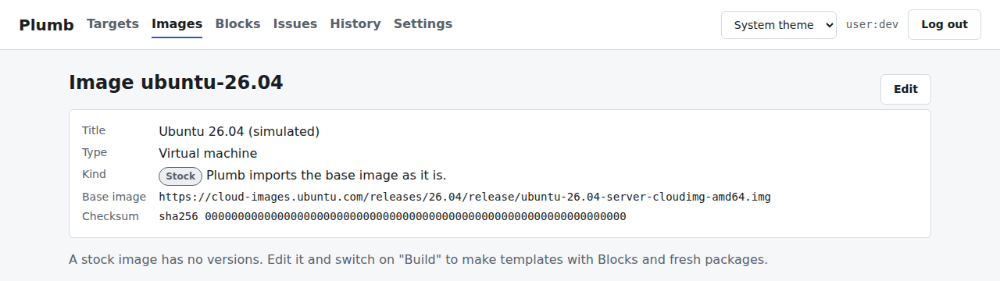
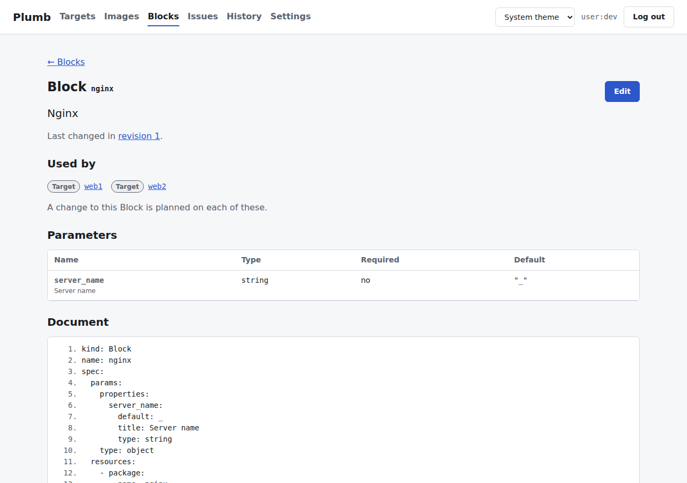
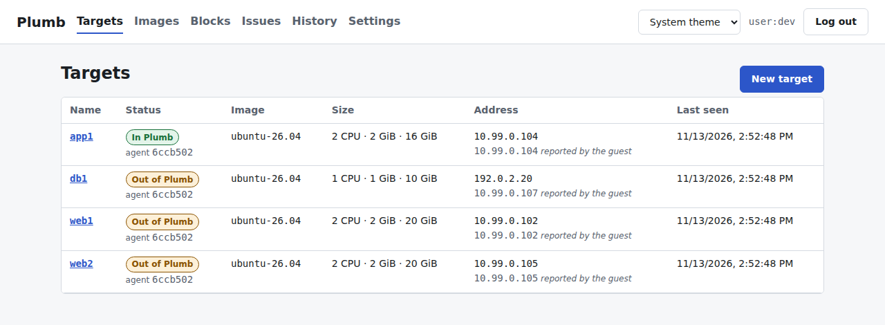
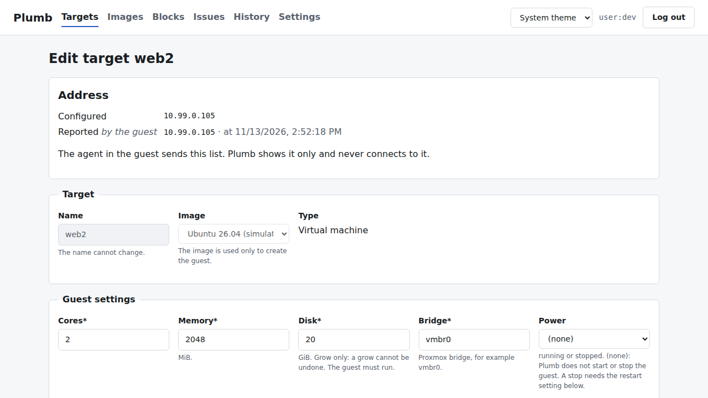
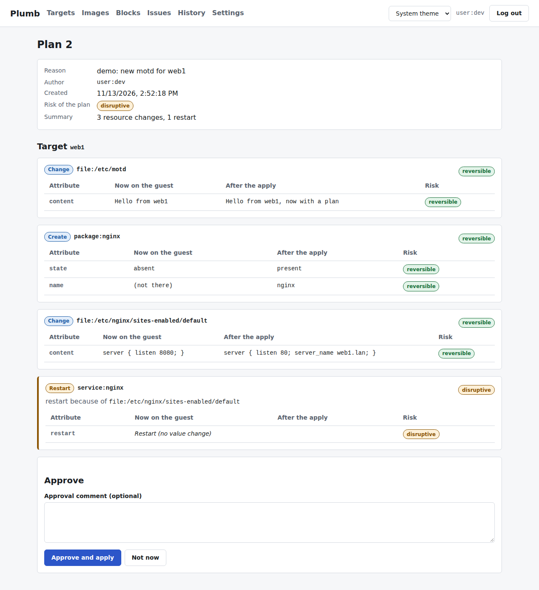
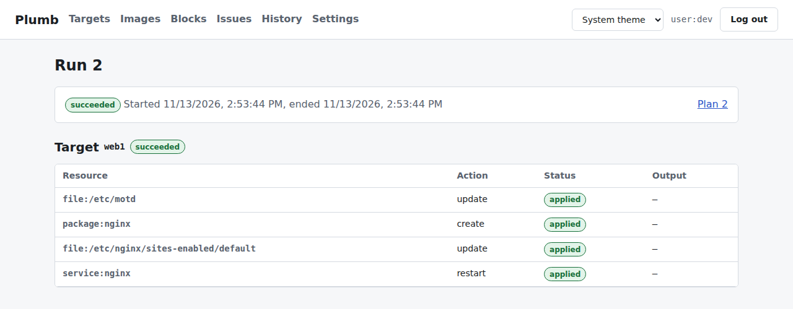
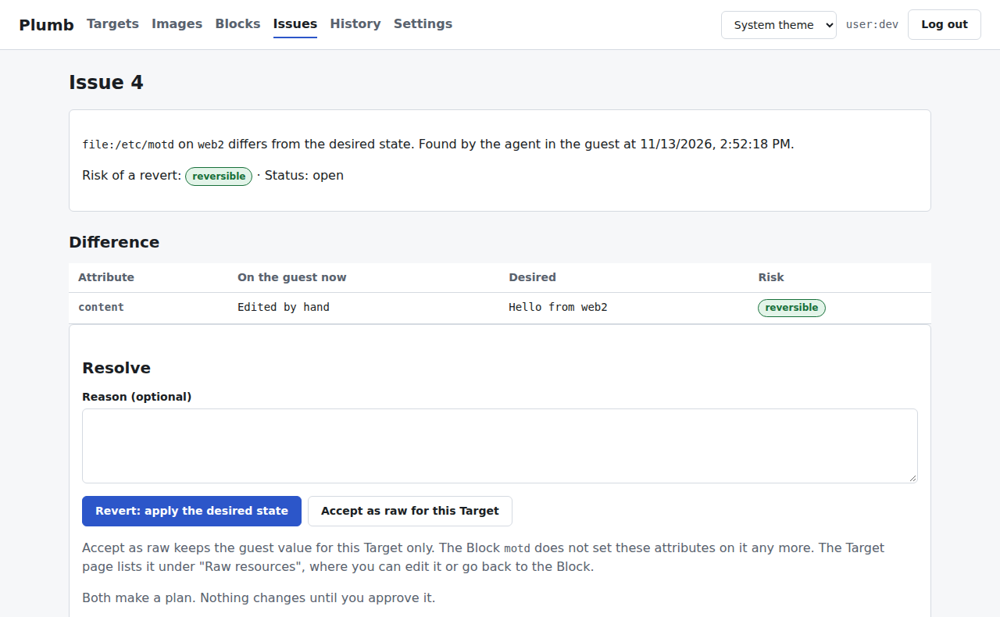
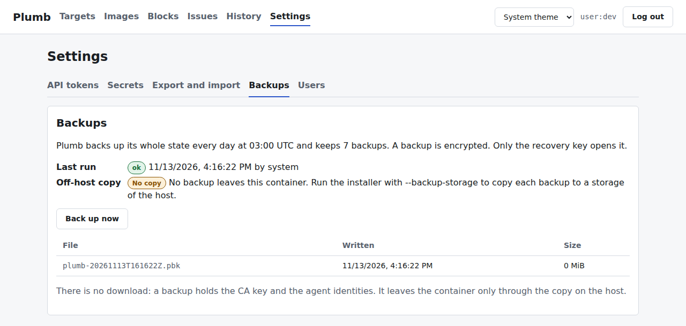

# Plumb

Plumb manages the virtual machines and containers on one Proxmox host. You run it yourself, in
your own network.

- **Images:** Plumb downloads cloud images and container templates. It can build its own Image
  versions from them, on a schedule, and keeps a fixed number of versions.
- **Targets:** a Target is one guest, a VM or an LXC container. Plumb creates it from an Image.
- **Blocks:** a Block is a reusable piece of configuration: files, packages, services, users and
  more. You add Blocks to a Target. An agent in the guest applies them.
- **Plans:** every change is a Plan first. The Plan shows each change and its risk. Nothing
  changes until you approve it.
- **Issues:** when a guest no longer matches its Target, Plumb opens an Issue. You revert the
  change, accept it, or ignore it.
- **History:** every approved change is a revision. You can see who changed what, and why.

You use Plumb in the web UI. Everything in the UI is also in the API. Guests run Debian 13 or
Ubuntu 26.04.

## Requirements

- Proxmox VE 9.1 or newer (qemu-server 9.2.11 or newer, libpve-storage-perl 9.1.13 or newer). The
  installer checks this and changes nothing on an older host.
- Root access to the host on a terminal (`ssh -t`). The installer asks questions and shows a key
  once.
- A storage for guest disks (default `local-lvm`) and a bridge (default `vmbr0`).
- A free IPv4 address for Plumb. Use a static address: the guests' agents keep this address. With
  DHCP, a new lease cuts off all agents.

## Install

### 1. Get the files

Until there is a release, build the binary yourself on a Linux machine with Go and Node.js 24 or
newer (versions: `go.mod`, `Makefile`):

```sh
git clone https://github.com/Bernotese/plumb.git
cd plumb && make build          # makes bin/plumb
```

Copy `bin/plumb` and `install/install.sh` to the Proxmox host.

### 2. Dry run

The dry run prints every command that would change the host. It changes nothing.

```sh
bash install.sh --plumb-binary ./plumb --lxc-ip <address>/<prefix> --lxc-gw <gateway> --dry-run
```

Read the list. Use `bash install.sh --help` for all options (storages, bridge, VMID range, DNS).

### 3. Real run

Run the same command without `--dry-run`. The installer asks before it changes anything.

It makes:

- an unprivileged Debian 13 LXC with the name `plumb` (2 cores, 1 GiB memory, 8 GB disk);
- a pool `plumb` for your guests, a user `plumb@pve` with an API token, and roles for it;
- the storages `plumb-snippets` and `plumb-images` (two directories on the host).

### 4. The recovery key

During the install, Plumb shows a **recovery key** once. Plumb does not store it.

- Write it down and keep it offline, for example in a password manager or on paper.
- Without it, Plumb cannot read its stored secrets again after a restore.
- Do not put it in a file on the Proxmox host or in a Plumb guest.

### What the Plumb token may do

Plumb never gets root access to Proxmox. Its token may:

- create, change, start, stop and delete guests in the pool `plumb`;
- use space on the disk storage and on `plumb-snippets`, and connect guests to the guest bridge;
- download images and templates into `plumb-images`.

It can also read, but never change, data of the whole host. It needs this right (`Sys.Audit` on
`/`) to see the free space of the disk storage, and Proxmox gives no narrower right for it. So
Plumb can read:

- the IDs, names and CPU, memory and disk use of **all** guests, also outside the pool;
- the task list of all users, root included (not the task logs);
- the backup jobs and the guests in them;
- the host and datacenter settings: disks and SMART data, `/etc/hosts`, the node config, and the
  cluster firewall rules.

It cannot read the configuration of a guest outside the pool, the syslog or the network settings.

It may not:

- change guests outside the pool;
- change the host, its network, its storages or its users;
- give rights to anybody, or make new pools;
- open a console or use the QEMU guest agent.

The Plumb LXC itself is not in the pool, so Plumb cannot change itself. The installer prints the
full list of rights.

## First steps

1. Open `https://<plumb-address>:8443`. The certificate comes from Plumb's own CA, so your browser
   warns you once. Plumb is for your local network only.
2. Log in as `admin`. The installer prints the first password once. If you lost it:
   `pct exec <plumb-vmid> -- journalctl -u plumb.service | grep Password`.
3. Set a new password. Plumb asks for it at the first login.
4. **Images:** add an Image (a Debian or Ubuntu cloud image, or a container template). You can
   switch on a build with Blocks and a schedule.

   
   <br>*An Image: where the base image comes from, and its checksum.*

5. **Blocks:** look at the starter Blocks (for example `deploy-user`, `ssh-hardening`, `nginx`,
   `docker-engine`, `firewall`). Change them or write your own. The `firewall` Block drops incoming
   traffic except the ports you list. SSH always stays open. When a firewall change cuts the guest
   off from Plumb, the agent puts the old rules back after 90 seconds.

   
   <br>*A Block: the Targets that use it, its parameters and its document.*

6. **Targets:** make a Target. Choose the Image, the size and the Blocks. Later you can change
   these on the Target, also through a Plan:
   - **Power:** "running" or "stopped". A stop needs "Plumb may restart this VM" (for a container:
     "this container") on the Target.
   - **Tags:** the Proxmox tags of the guest. Plumb keeps exactly these. A new Target with no
     entry: Plumb does not touch its tags.
   - **Disk:** it only grows. Proxmox cannot make a disk smaller, so a grow cannot be undone.

   
   <br>*The Targets: one is in Plumb, three have drift.*

   
   <br>*One Target: its address, its Image and its guest settings.*

7. **Plan:** "Show the plan" opens the Plan. Read it, then click "Approve and apply". The Run shows
   each step.

   
   <br>*A Plan: every change with its old value, new value and risk. Nothing changes before you approve it.*

   
   <br>*The Run of that Plan: each step on each Target.*

8. **Issues:** when somebody changes a guest by hand, an Issue opens. Choose "Revert", "Accept" or
   "Ignore". A Plan that accepts a value from the guest needs a person: an API token cannot approve
   it.

   
   <br>*An Issue: someone edited a file in the guest by hand. Revert it, accept it, or ignore it.*

In **Settings** you make API tokens, store secrets, and export or import the whole state.

## Updates and repair

To update Plumb, run the new `install.sh` with the new `plumb` binary. Use the same options as at
the install. The same run repairs a broken install. Try `--dry-run` first.

Agents in the guests update through a Plan: Plumb proposes it, you approve it.

- An agent that does not reach Plumb within 5 minutes after the update goes back to its old
  version by itself.

**Guests made before the agent self-update existed** need one root command per guest, once:

```sh
# LXC, on the Proxmox host:
pct exec <vmid> -- sh -c 'systemctl stop plumb-agent.service && /usr/local/sbin/plumb-agent-install'
# VM, over SSH or the console, as root:
systemctl stop plumb-agent.service && /usr/local/sbin/plumb-agent-install
```

After it, the Target page shows the new agent version. A guest without
`/usr/local/sbin/plumb-agent-install` must be made again.

An update never changes a stored Block. If your `nginx` or `nginx-site` Block answers 403, replace
its `index index.html;` line with `index index.html index.htm index.nginx-debian.html;`.

To remove Plumb: `bash install.sh --remove`. It refuses while the pool still holds guests or
templates. Delete them through Plumb first.

## Backup and restore

### What a backup holds

Plumb backs up its whole state every day at 03:00 UTC and keeps the last 7 backups (installer
options `--backup-time` and `--backup-keep`). **Settings → Backups** shows them, and "Back up now"
makes one at once.


<br>*Settings → Backups: the schedule, the last run, the off-host copy and the backups.*

A backup is encrypted. Only your recovery key opens it.

- It holds: every Image, Block, Target, rule and revision, the history, the Issues, the users and
  tokens, which guest belongs to which Target, and the identities of the agents.
- It does not hold: the recovery key, the Proxmox token of Plumb (the installer makes a new one),
  and the guests themselves. Back up the guests with Proxmox.

### Copy the backups off the host

The backups live in the Plumb LXC. If the disk of the host dies, they die with it. Copy them to a
storage on another device, for example an NFS or CIFS share:

```sh
bash install.sh --plumb-binary ./plumb <your usual options> --backup-storage <storage>
```

The host copies the newest backup to `<storage path>/plumb-backups/` every day (30 minutes after
the backup) and keeps 14 copies. The storage must exist in Proxmox (`dir`, `nfs`, `cifs` or
`cephfs`). A directory on the same host is not an off-host copy. Settings → Backups shows the state
of the last copy. `--backup-storage none` stops the copies; the copies stay.

Check a copy now and then on the host. It asks for the recovery key and changes nothing:

```sh
./plumb backup verify <storage path>/plumb-backups/<file>.pbk
```

This proves that the file opens with your key. Only a real restore proves the whole way back.

### Replace the controller

To move Plumb to a new LXC, or after the Plumb LXC broke, keep the guests and restore:

1. Remove only the controller. Plumb takes a fresh backup, copies it to the backup storage, and
   checks it with your recovery key. A wrong key stops here, before any change. The pool and its
   guests stay.

   ```sh
   bash install.sh --remove --keep-guests --plumb-binary ./plumb
   ```

   Without `--backup-storage` at the install, add `--backup-to <directory>`: a directory on this
   host. That is not an off-host copy; the installer warns you.
2. Restore. The installer prints this line at the end of step 1. Use the same address as before:
   the agents in the guests know only this address.

   ```sh
   bash install.sh --plumb-binary ./plumb --restore <file>.pbk --lxc-ip <address>/<prefix> --lxc-gw <gateway>
   ```

   It asks for the recovery key and checks the file before it changes anything. A wrong key stops
   the run.

### After a restore

- The installer shows a new password for `admin` once. Write it down. The first login asks for a
  new one. The old passwords do not work any more.
- Plumb starts in **restored mode**: it reads Proxmox and the agents, but it changes nothing. No
  Plan is applied and no backup runs. A banner says so.
- Every API token is disabled. Enable only the ones you still need, in Settings → API tokens.
- When the old controller is off for good, confirm it in **Settings → Backups**. Only then does
  Plumb work normally again. If two controllers run, both change the same guests.
- Guests that were made after the backup are listed as unknown guests. Plumb never changes or
  deletes them. A guest that was deleted after the backup gets an Issue; Plumb does not make it
  again by itself.

### Export and import

**Settings → Export and import** saves one YAML file with every Image, Block, Target and rule. It
does not hold the history, the Issues, the users or the tokens. It does not hold which guest belongs
to which Target, or the agent identities: a new Plumb made from it creates new guests. Secret
values are in it only when you give a passphrase.

Keep the recovery key in any case.

## Known limits

- A **stock Ubuntu 26.04** image used directly by a Target can stay on DHCP until its first
  restart. Use DHCP, or let Plumb build the Image: a built Image does not have this limit.
- The **5 minute agent guard:** when Plumb is not reachable for more than 5 minutes right after an
  agent update, the agent also goes back to its old version. A new update Plan installs it again.
- A change of cores or memory of a running VM waits for a restart. Switch on "Plumb may restart
  this VM" on the Target if Plumb may restart it.
- One Proxmox host only. No clusters.
- A restored Plumb needs the same address as before.
- There is one user, `admin`. More users come later.
- A guest has one network card. More cards and other network settings come later.

## More

- [docs/BRIEF.md](docs/BRIEF.md): what Plumb is for.
- [docs/ARCHITECTURE.md](docs/ARCHITECTURE.md): how it works inside.
