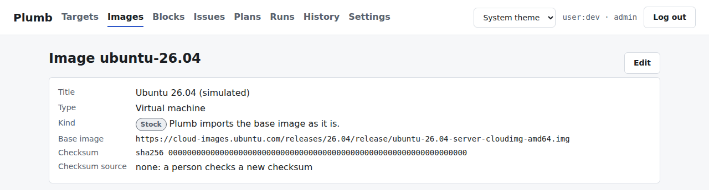
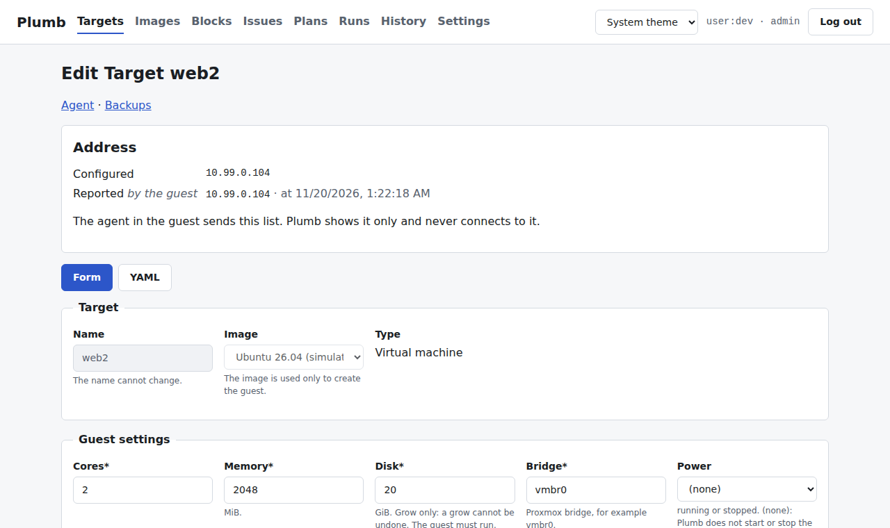
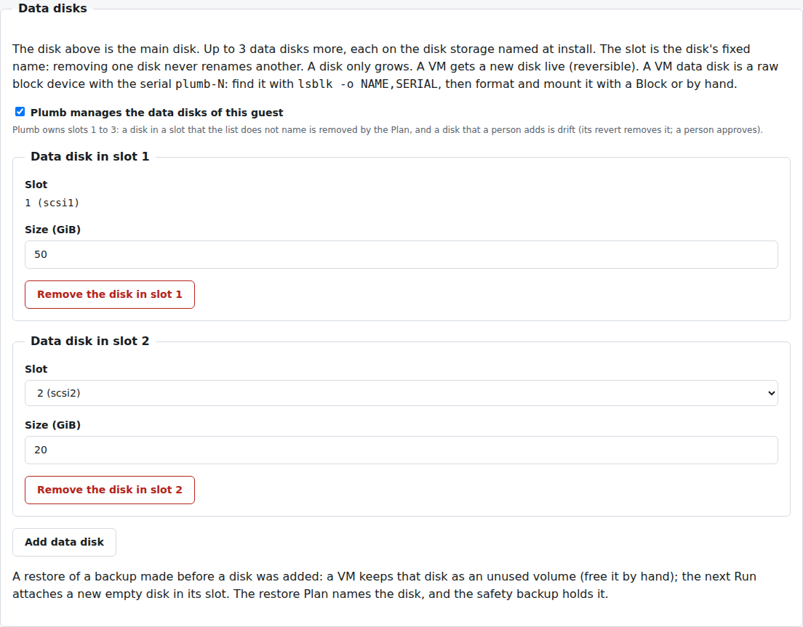
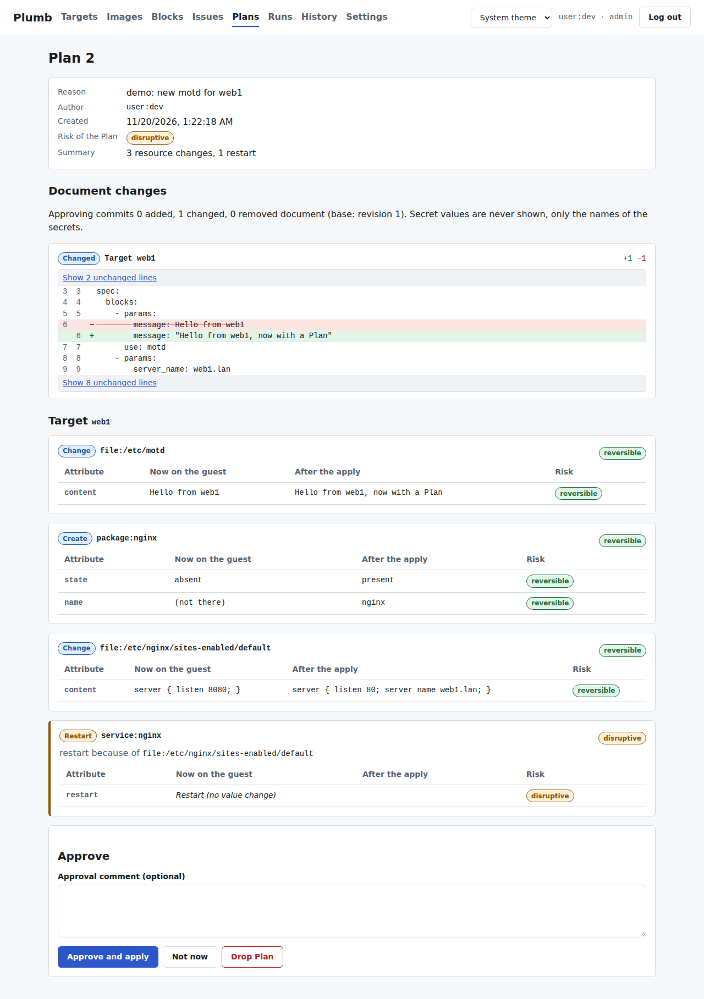
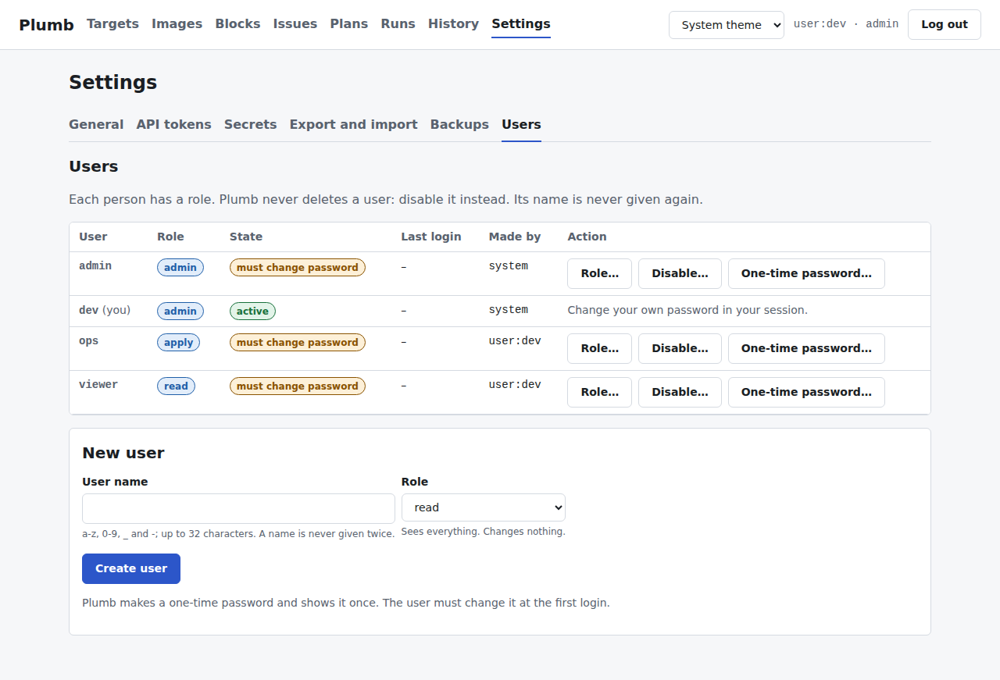
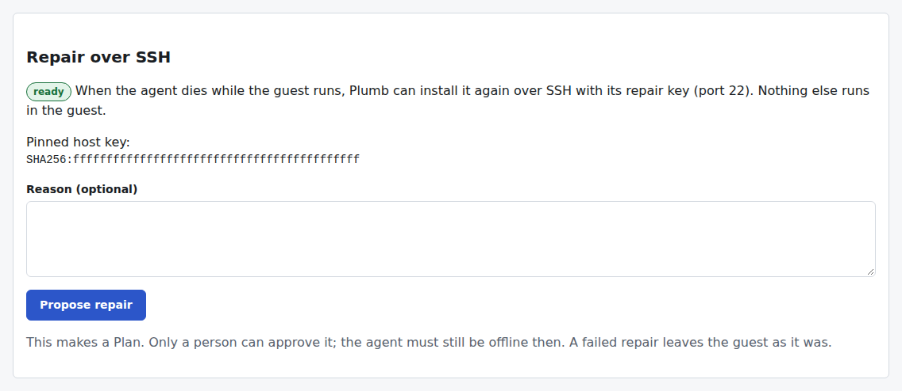
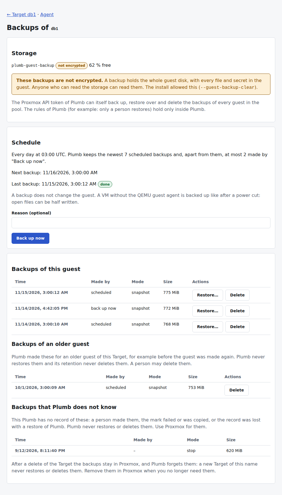

# Plumb

Plumb manages the virtual machines and containers on one Proxmox host. You run it yourself, in
your own network.

- **Images:** Plumb downloads cloud images and container templates. It can build its own Image
  versions from them, on a schedule, and keeps a fixed number of versions.
- **Targets:** a Target is one guest, a VM or an LXC container. Plumb creates it from an Image.
- **Blocks:** a Block is a reusable piece of configuration: files, packages, services, users and
  more. You add Blocks to a Target. An agent in the guest applies them.
- **Plans:** every change is a Plan first. The Plan shows each change and its risk. Nothing
  changes until you approve it.
- **Users:** each person has their own login and a role: read, plan, apply or admin.
- **Issues:** when a guest no longer matches its Target, Plumb opens an Issue. You revert the
  change, accept it, or ignore it.
- **History:** every approved change is a revision. You can see who changed what, and why.

You use Plumb in the web UI. Everything in the UI is also in the API. Guests run Debian 13 or
Ubuntu 26.04.

## Requirements

- Proxmox VE 9.1 or newer (qemu-server 9.2.11 or newer, libpve-storage-perl 9.1.13 or newer). The
  installer checks this and changes nothing on an older host.
- Root access to the host on a terminal (`ssh -t`). The installer asks questions and shows a key
  once.
- A storage for guest disks (default `local-lvm`) and a bridge (default `vmbr0`).
- A free IPv4 address for Plumb. Use a static address: the guests' agents keep this address. With
  DHCP, a new lease cuts off all agents.

## Install

### 1. Get the files

Until there is a release, build the binary yourself on a Linux machine with Go and Node.js 24 or
newer (versions: `go.mod`, `Makefile`):

```sh
git clone https://github.com/Bernotese/plumb.git
cd plumb && make build          # makes bin/plumb
```

Copy `bin/plumb` and `install/install.sh` to the Proxmox host.

**From a release tarball** (when there is one): unpack it on the host as root, into a folder that only root can write (the installer refuses a folder or file that another account can write), and run its `install.sh` with
`--plumb-binary ./plumb` from that folder. Before it uses any file, the installer checks the
tarball's `SHA256SUMS`: every file must be there and match, and `--plumb-binary` must be the
`plumb` of the tarball; else it stops, names the file and changes nothing (the dry run shows the
check too). This proves only that the files are whole, not who made them.

**Check the installer before you run it.** `install.sh` can check itself only while it runs, so it
cannot prove that it is the right one. Only these two steps, **before** you unpack, prove the
whole tarball, `install.sh` included: `gh attestation verify` with the options of `docs/RELEASE.md` (who built it, and that it was the
release workflow on `main`) and the outer
`SHA256SUMS` (see `docs/RELEASE.md`). The installer of a release says "Bundle check of release
…"; if the installer of a tarball says "source build" instead, stop: it is not the installer of
a release. A build from source has no `SHA256SUMS`; it says so and checks nothing.

Run it from a clean root shell (for example `sudo -i`), not through `sudo -E` or a wrapper that
passes your environment: `BASH_ENV` and `PATH` act before the first line of the script, so no
check in it can stop them. A release installer refuses the test settings `PLUMB_INSTALL_*`, and it uses `/tmp` for its temp
files: it refuses any other `TMPDIR`.

### 2. Dry run

The dry run prints every command that would change the host. It changes nothing.

```sh
bash install.sh --plumb-binary ./plumb --lxc-ip <address>/<prefix> --lxc-gw <gateway> --dry-run
```

Read the list. Use `bash install.sh --help` for all options (storages, bridge, VMID range, DNS).

### 3. Real run

Run the same command without `--dry-run`. The installer asks before it changes anything.

It makes:

- an unprivileged Debian 13 LXC with the name `plumb` (2 cores, 1 GiB memory, 8 GB disk);
- a pool `plumb` for your guests, a user `plumb@pve` with an API token, and roles for it;
- the storages `plumb-snippets` and `plumb-images` (two directories on the host).

Two kinds of options are off unless you name them:

- **More networks for guests:** `--extra-bridge <bridge>` lets a guest network card use one more
  bridge, untagged. `--extra-vlan <bridge>:<tag>[,<tag>…]` allows these VLAN tags on a VLAN-aware
  bridge. Repeat each option for more. A Target can use only the bridges and tags named here. A
  later run (a repair run) sets this list from its options alone: give every extra bridge and VLAN
  again, or its right is removed.
- **Guest backups:** `--guest-backup-storage <storage>` names the one storage for backups of your
  guests. The installer refuses a storage that can also hold guest disks or snippets (content
  `images`, `rootdir` or `snippets`). A Proxmox Backup Server storage with an encryption key keeps the backups encrypted.
  On any other storage, Plumb makes guest backups only when you add `--guest-backup-clear`: the
  backups are then **not encrypted**, and each one holds the whole guest disk with every secret in
  it.

The dry run lists each right that these options add.

### 4. The recovery key

During the install, Plumb shows a **recovery key** once. Plumb does not store it.

- Write it down and keep it offline, for example in a password manager or on paper.
- Without it, Plumb cannot read its stored secrets again after a restore.
- Do not put it in a file on the Proxmox host or in a Plumb guest.

### What the Plumb token may do

Plumb never gets root access to Proxmox. Its token may:

- create, change, start, stop and delete guests in the pool `plumb`;
- use space on the disk storage and on `plumb-snippets`, and connect guests to the guest bridge;
- download images and templates into `plumb-images`.
- with `--extra-bridge` or `--extra-vlan`: connect guests to exactly those bridges and VLAN tags;
- with `--guest-backup-storage`: back up the guests of the pool to that storage, and use its space.

With guest backups on, the token itself can back up, restore over and delete the backups of every
guest in the pool directly at the Proxmox API. Plumb's own rules (for example "only a person
restores a guest") hold only inside Plumb, not for somebody who holds the token.

It can also read, but never change, data of the whole host. It needs this right (`Sys.Audit` on
`/`) to see the free space of the disk storage, and Proxmox gives no narrower right for it. So
Plumb can read:

- the IDs, names and CPU, memory and disk use of **all** guests, also outside the pool;
- the task list of all users, root included (not the task logs);
- the backup jobs and the guests in them;
- the host and datacenter settings: disks and SMART data, `/etc/hosts`, the node config, and the
  cluster firewall rules.

It cannot read the configuration of a guest outside the pool, the syslog or the network settings.

It may not:

- change guests outside the pool;
- change the host, its network, its storages or its users;
- give rights to anybody, or make new pools;
- open a console or use the QEMU guest agent.

The Plumb LXC itself is not in the pool, so Plumb cannot change itself. The installer prints the
full list of rights.

## First steps

1. Open `https://<plumb-address>:8443`. The certificate comes from Plumb's own CA, so your browser
   warns you once. Plumb is for your local network only.
2. Log in as `admin`. The installer prints the first password once. If you lost it:
   `pct exec <plumb-vmid> -- journalctl -u plumb.service | grep Password`.
3. Set a new password. Plumb asks for it at the first login.
4. **Images:** add an Image (a Debian or Ubuntu cloud image, or a container template). You can
   switch on a build with Blocks and a schedule.

   
   <br>_An Image: where the base image comes from, and its checksum._

   An Image keeps a fixed checksum (the pin). To move it to a newer file, choose a **signed
   checksum source** on the Image:
   - Ubuntu cloud images: Plumb checks `SHA256SUMS` with the Ubuntu key that is built into Plumb.
   - Proxmox container templates: Plumb checks the appliance index with the Proxmox key that is
     built into Plumb.
   - Debian cloud images: Plumb reads `SHA512SUMS` over HTTPS. Debian does not sign this list.

   Then click **Refresh base** on the Image. When the file changed, Plumb proposes a Plan that
   changes only the checksum. Existing Targets do not change; new Targets and new builds use the
   new file.

   
   <br>_An Image with a signed checksum source, and the "Refresh base" button._

5. **Blocks:** the **starter catalogue** on the Blocks page lists the Blocks that ship with Plumb
   (for example `deploy-user`, `ssh-hardening`, `nginx`, `docker-engine`, `firewall`, `network`).
   "Add" copies one into your Blocks. When your copy differs from the catalogue, "Show difference"
   shows how, and "Update from the catalogue" replaces your copy. Both make a normal Plan. Plumb
   never adds or changes a Block by itself. Change the Blocks or write your own.
   - The `firewall` Block drops incoming traffic except the ports you list, on every network card of
     the guest. SSH always stays open.
   - The `network` Block adds addresses, routes, name servers and search domains to the network
     card of a VM. The main address, the gateway and DHCP do not change.
   - When a `firewall` or `network` change cuts the guest off from Plumb, the agent puts the old
     settings back after 90 seconds.
   - A Block can also hold a local `group` (`groupadd`). Users join it through their `groups`.

   
   <br>_The starter catalogue: "Add" and "Update" make a Plan. Plumb never changes a Block by itself._

   
   <br>_A Block: the Targets that use it, its parameters and its document._

6. **Targets:** make a Target. Choose the Image, the size and the Blocks. Later you can change
   these on the Target, also through a Plan:
   - **Power:** "running" or "stopped". A stop needs "Plumb may restart this VM" (for a container:
     "this container") on the Target.
   - **Tags:** the Proxmox tags of the guest. Plumb keeps exactly these. With no entry, Plumb does
     not touch the tags of the guest.
   - **Disk:** it only grows. Proxmox cannot make a disk smaller, so a grow cannot be undone.
   - **More network cards:** up to 3 more, each on a bridge, or a bridge with a VLAN tag, that the
     install named. Each card has no address, DHCP, or a static address; at most one card has a
     gateway. Plumb chooses the MAC addresses. Adding or removing a card, or changing its bridge or
     tag, is disruptive: the Plan says so.
     - A container gets the address of each card from Proxmox.
     - In a VM, the agent sets it with netplan and finds the card by Plumb's MAC address. It
       refuses, and changes nothing, when a netplan entry names the card only by a pattern, or when
       two entries name it.
     - A VM card gets a gateway only while the first card has no default route (also none from
       DHCP).
     - A running VM gets or loses a card without a restart while network hot-plug is on (the
       Proxmox default); else the change waits for a restart. The agent removes the netplan file of
       a removed card. A card that comes back gets the same MAC address.
     - Plumb refuses the Plan for a bridge or a VLAN tag that the install did not name. The message
       names the installer options that it needs (`--extra-bridge`, `--extra-vlan`). Run the
       installer again with every extra bridge and VLAN that the install has now, plus these (see
       "Updates and repair").
   - **Data disks:** up to 3 more disks after the main disk, on the disk storage that the install
     named. Tick "Plumb manages the data disks of this guest" to manage them; then each disk has a
     **slot** (1 to 3) and a size. The slot is the disk's fixed name (a VM `scsi1` … `scsi3`, a
     container `mp1` … `mp3`): removing one disk never renames another.
     - **VM:** a data disk is a raw block device with the serial `plumb-<slot>`. Find it in the
       guest with `lsblk -o NAME,SERIAL` (it is not in `/dev/disk/by-id`). Formatting and mounting
       it is yours: with a Block or by hand. Plumb adds it live (reversible).
     - **Container:** give a mount path, for example `/srv/data`. Proxmox makes a file system on the
       disk and mounts it there. The path cannot change later, and it cannot be in a system folder
       (`/etc`, `/usr`, `/var`, `/lib…` and the others) or inside another disk's path. Plumb adds a
       container disk only while the container is stopped: the Run stops a running container,
       adds the disk and starts it again. That needs "Plumb may restart this container", and the
       Plan is disruptive. If the container does not start with the new disk (for example because
       a part of the path is a symbolic link in the guest), the Run removes the disk again and
       starts the container as before. A stopped container gets the disk and stays stopped (the
       Plan is reversible); the disk is then tried only at its next start, and if that start
       fails, remove the disk with a Plan.
     - A disk only grows. A grow is disruptive, as for the main disk.
     - **Removing a disk deletes its data.** The Plan is destructive, and only a person can approve
       it. A running guest needs "Plumb may restart this VM" (for a container: "this container").
       The Run detaches the disk first, then frees its volume in a second step. A disk that Plumb
       did not make is only detached, never freed.
     - **If Plumb cannot free a volume**, the Run says so and Plumb opens the Issue
       `guest:volume-left`, which names the volume. No disk is added to the Target until it is gone.
       Remove it on the Proxmox host as root: `qm set <vmid> --delete unusedN` (for a container
       `pct set`), with the `unusedN` line that names the volume, or `pvesm free <volume>` when no
       such line names it. A delete of the Target also frees it. The Issue ends by itself at the
       next check (about a minute) when the guest config no longer names the volume.
       - A common cause is a **snapshot** of the guest that still uses the disk ("volume is still in
         use (snapshot?)"). Remove the snapshot first (`qm delsnapshot <vmid> <name>`), then the
         `unusedN` line.
       - Never `pvesm free` a volume that an `unusedN` line still names: the line stays, the Issue
         stays open, and a later snapshot delete can leave the guest locked.
     - A disk that grew in Proxmox is drift: "Accept" takes the bigger size into the Target, and
       there is no Revert (a disk cannot shrink). Deleting the Target deletes its data disks too;
       the Plan names each of them.
     - With the box off, Plumb does not touch data disks, and a disk that a person adds is no
       drift. Switching it off deletes nothing. Switching it on manages slots 1 to 3. Read that Plan
       before you approve it:
       - A disk of a slot that the list does not name is removed, or detached when Plumb did not
         make it.
       - **A disk that a person added to a VM** has no serial `plumb-N`, so Plumb never takes it
         over. If the list names its slot, Plumb refuses the Plan (remove the disk in Proxmox, or use
         another slot); else the Plan detaches it and does not free it. To keep it as it is, leave
         the box off.
       - **A disk that a person added to a container** on the disk storage of the install counts as
         Plumb's: list it with its slot, size and path to keep it. A disk on another storage, a bind
         mount or a device, Plumb did not make: as for a VM, the Plan refuses or detaches it.
     - Every disk counts for the 85 % gate of the disk storage. A user or token with the role
       apply can approve an add (up to 3 × 4096 GiB per Target), but no remove.
     - An adopted Target keeps the disks that the guest has; Plumb adds none.
   - **Guest backups:** daily or weekly at a time (UTC), and how many to keep. See "Guest backups"
     below.

   
   <br>_The Targets: one is in Plumb, three have drift._

   
   <br>_One Target: its address, its Image and its guest settings._

   
   <br>_The data disks of a VM: the slot is the disk's fixed name, and a disk only grows._

7. **Plan:** "Show the plan" opens the Plan. Read it, then click "Approve and apply". The Run shows
   each step. A Run can end as "succeeded, N warnings": then read the steps marked `warning`. The
   Plan shows two things:
   - **Document changes:** what changes in your Images, Blocks, Targets and rules, as a diff. Secret
     values are never shown, only the names of the secrets.
   - **Targets:** each change on each guest, with its old value, new value and risk. A change to a
     Block that no Target uses has document changes only.

   
   <br>_A Plan: every change with its old value, new value and risk. Nothing changes before you approve it._

   
   <br>_The Run of that Plan: each step on each Target._

   
   <br>_A Plan that changes only a Block: its document changes, line by line._

8. **Issues:** when somebody changes a guest by hand, an Issue opens. Choose "Revert", "Accept" or
   "Ignore". A Plan that accepts a value from the guest needs a person: an API token cannot approve
   it. The same holds for every Plan that takes a value that a guest reported into the desired
   state, also when you type it yourself: only a person can approve it.
   - **Accept into a parameter:** when the changed value comes from one Block parameter, Accept
     writes the guest value into that parameter of this Target ("Accept into parameter message of
     motd"). The Block itself does not change. When no parameter fits, Accept keeps the value as a
     raw resource of this Target, and the Issue says why.
   - A Plan that removes the `firewall` of a Target always needs a person, because it opens every
     port at once.
   - A network card changed in Proxmox (bridge, tag, MAC, a card added or removed) cannot be
     accepted. Revert it, or change the network cards of the Target.

   
   <br>_An Issue: someone edited a file in the guest by hand. Revert it, accept it, or ignore it._

In **Settings** you make API tokens, store secrets, and export or import the whole state. Under
**Settings → General** an admin changes the backup time and the number of backups to keep; a value
set there wins over the value of the install, and "Use the install value again" goes back. The same
tab shows the Proxmox connection (node, pool, storages, version, the token's user and its rights)
and the repair key. It never shows a secret.


<br>_Settings → General: the backup schedule and the Proxmox connection._

### AI clients (MCP)

`plumb mcp` lets an AI client (for example Claude) read Plumb and propose changes, through the
Model Context Protocol over stdio. It uses the public API with an API token.

1. In **Settings → API tokens**, make a token with the tier **plan**. Plumb shows it once. Save it
   in a file that only you can read: `chmod 600 ~/.config/plumb/token`.
2. Copy the CA of Plumb, on the Proxmox host:
   `pct pull <plumb-vmid> /var/lib/plumb/link/ca.crt ~/.config/plumb/ca.crt`.
3. Add Plumb to the client's MCP configuration:

   ```json
   {
     "mcpServers": {
       "plumb": {
         "command": "plumb",
         "args": [
           "mcp",
           "--url",
           "https://<plumb-address>:8443",
           "--token-file",
           "/home/<you>/.config/plumb/token",
           "--ca",
           "/home/<you>/.config/plumb/ca.crt"
         ]
       }
     }
   }
   ```

What the client **can** do (and nothing else):

- read Targets, Issues (with the difference and the comments), Plans (with their changes and
  documents), Runs, revisions and their difference, Blocks, Images, the starter catalogue, and the
  events since a given point;
- propose a change of Targets, Blocks or Images (a Plan);
- Revert or Accept an Issue (a Plan), re-enroll a Target (a Plan), and drop a Plan;
- comment on an Issue.

What it can **never** do: approve a Plan, ignore drift (once or by rule), or touch secrets,
tokens, users, settings, backups, restore, export or import; nor update an agent or build or refresh
an Image. You approve every Plan in the web UI; the Plan shows the client's reason below the
changes, marked "written by API token". A Plan that takes a value a guest reported, or that removes
a firewall, needs a person in any case. A token may make 30 Plans and 30 comments per minute; above
that Plumb refuses the call and says how long to wait.

#### Explain an Issue

The prompt **explain_issue** (argument: the Issue id) gives the client one Issue with what it
needs: the difference, the Target and its Blocks, the source of the resource, the last 5 Runs of
the Target and the last 20 comments (comments of people and of Plumb first, then those of tokens). The client then explains the Issue in a comment and may
propose **one** Revert or Accept of this Issue. You approve it in the web UI, as every Plan.

- Use a token with the tier **plan**. A **read** token gets an error for this prompt.
- Everything that comes from a guest or a person (reported values, comments, Run output, Block
  text, parameters) is marked as untrusted data in the prompt. Plumb tells the client never to
  follow instructions found in it, but to report them in its comment. If a comment of the client
  says that it found such instructions, look at who wrote them.
- The prompt holds no secret: a sensitive value shows only that it differs.
- Long texts and long lists are cut, and the prompt says where and how much. The client then has a
  partial view. An Issue too big for the prompt shows only its id and no action: read it in Plumb.

### Users and roles

An admin adds people in **Settings → Users**. Each user has one role:

| Role  | May                                                                                                                               |
| ----- | --------------------------------------------------------------------------------------------------------------------------------- |
| read  | See everything. Change nothing.                                                                                                   |
| plan  | Also propose changes (Plans), comment on Issues, and drop Plans.                                                                  |
| apply | Also approve Plans up to the risk "disruptive", ignore drift once, and start a backup now.                                        |
| admin | Everything: destructive Plans, users, API tokens, secrets, an export with secret values, import, and the confirm after a restore. |

- Plumb makes a one-time password for a new user and shows it once. The user must change it at the
  first login.
- Plumb never deletes a user. Disable it instead. A name is never given twice.
- A role change ends every session of that user.
- The web UI hides the buttons that your role may not use. Plumb also checks every call itself.


<br>_Settings → Users: each person with their role and state._

## Updates and repair

To update Plumb, run the new `install.sh` with the new `plumb` binary. Use the same options as at
the install. The same run repairs a broken install. Try `--dry-run` first.

Agents in the guests update through a Plan: Plumb proposes it, you approve it.

New rights come only with an installer run. To use more networks or guest backups on an existing
install, run the installer again with your usual options and the new ones (`--extra-bridge`,
`--extra-vlan`, `--guest-backup-storage`). Until then Plumb refuses such a network card and every
guest backup, and says why. Give these options again at every later run: a run without one of them
removes its rights.

- An agent that does not reach Plumb within 5 minutes after the update goes back to its old
  version by itself.

### Repair a dead agent

When the agent of a running guest is offline, the agent page offers **Propose repair**. Plumb
refuses it during the first 10 minutes, because an agent may only be cut off for a short time. Only
a person can approve the repair Plan. After the approval, Plumb connects to the guest over SSH with
its own repair key and installs the agent again; nothing else runs in the guest. A failed repair
leaves the guest as it was.

- The agent writes a key line for root that allows only this install, and only from Plumb's
  address. The agent page says "ready" or why not. In the `ssh-hardening` Block, the
  `permit_root_login` values `prohibit-password` (the default) and `forced-commands-only` both allow
  the repair; `no` turns it off.
- Plumb pins the SSH host keys that the agent reported, and the repair connects only to a pinned
  key. A new host key shows as a warning. When no pinned key is left (the guest got new host keys), the
  repair is off until you accept one of the new keys in the repair Plan; check it on the guest
  first, for example with `ssh-keygen -lf /etc/ssh/ssh_host_ed25519_key.pub`.
- **Settings → General** shows the repair key. "Make a new repair key" makes a new one; the old key
  stays valid until you revoke it.
- Without a repair over SSH (a container without SSH, a guest that never had the line, an adopted
  guest), an admin makes an **install command** on the agent page: one root command for the guest,
  valid once for 15 minutes. It holds a one-time token, so treat it as a secret; Plumb shows it only
  once. **It needs `curl` in the guest**; a stock Debian LXC has none. Install it first
  (`apt-get install -y curl`). Every error line of the command and of the install script starts
  with `plumb-install:`. Without `curl`, or when the download fails or is cut, the command stops
  with one such line, installs nothing and leaves no file; you can run the same command again.
- The shell keeps a pasted command, with the token, in root's history. Run `unset HISTFILE` before
  you paste it, or `history -c` after it. After a failed try, the token stays valid until its time
  ends.


<br>_A dead agent: Plumb can install it again over SSH, after a person approves the plan._

### Adopt a guest

Plumb can take over a guest that you made yourself. Move the guest into the Proxmox pool `plumb`
first; Plumb never moves a guest into the pool. Then open **Targets → Adopt a guest**.

- The list shows each free guest of the pool, and why a guest cannot be adopted (for example more
  than one disk, a VLAN tag, a privileged container).
- The new Target has the Proxmox name of the guest; rename the guest in Proxmox to change it.
- An adopted Target keeps one network card: Plumb adds no more cards to it.
- Adopting is a Plan that only a person can approve. Plumb writes nothing to Proxmox for it.
- The guest is **not sealed**: its SSH host keys, machine-id and root users stay as they are.
  Plumb never keeps or shows its password, SSH keys, description or container environment.
- Install the agent with the install command on the agent page (it needs `curl` in the guest; see
  "Repair a dead agent").
- **Delete:** deleting an adopted Target lets the guest go: Plumb removes its agent, and the guest
  and its disks stay in Proxmox. Only when you first allow it with a separate plan ("Allow Plumb to
  delete the guest", it sets `delete_guest`) does deleting the Target delete the Proxmox guest and its
  disks. Both need a person.
- When the agent does not answer during the delete, the Run ends as "succeeded, 1 warning" and the
  agent stays in the guest with its repair key line. The guest then shows under **Adopt a guest**
  as not adoptable ("the Plumb agent of a deleted Target is still in it"). Plumb removes the agent
  when it comes back. Or remove it by hand (the warning step names the commands) and choose
  "Forget the agent…" (admin).


<br>_Adopt a guest: the warnings come before the plan._

### Guests made before the agent self-update

**Guests made before the agent self-update existed** need one root command per guest, once:

```sh
# LXC, on the Proxmox host:
pct exec <vmid> -- sh -c 'systemctl stop plumb-agent.service && /usr/local/sbin/plumb-agent-install'
# VM, over SSH or the console, as root:
systemctl stop plumb-agent.service && /usr/local/sbin/plumb-agent-install
```

After it, the Target page shows the new agent version. A guest without
`/usr/local/sbin/plumb-agent-install` must be made again.

An update never changes a stored Block. If your `nginx` or `nginx-site` Block answers 403, replace
its `index index.html;` line with `index index.html index.htm index.nginx-debian.html;`.

To remove Plumb: `bash install.sh --remove`. It refuses while the pool still holds guests or
templates. Delete the Targets and Images through Plumb first, then remove in Proxmox the templates
that stay (see "Known limits").

## Backup and restore

### What a backup holds

Plumb backs up its whole state every day at 03:00 UTC and keeps the last 7 backups (installer
options `--backup-time` and `--backup-keep`, or **Settings → General**). **Settings → Backups**
shows them, and "Back up now" makes one at once. A file that Plumb cannot read is listed as
unreadable: give it to the user `plumb` in the container.


<br>_Settings → Backups: the schedule, the last run, the off-host copy and the backups._

A backup is encrypted. Only your recovery key opens it.

- It holds: every Image, Block, Target, rule and revision, the history, the Issues, the users and
  tokens, which guest belongs to which Target, and the identities of the agents.
- It does not hold: the recovery key, the Proxmox token of Plumb (the installer makes a new one),
  and the guests themselves. Back up the guests with Plumb's guest backups (below) or with Proxmox.

### Guest backups

With `--guest-backup-storage` at the install, Plumb backs up the guests of your Targets. Set
**Guest backups** on a Target: daily or weekly, a time (UTC), and how many backups to keep (1 to
30). A backup does not change the guest. It is a snapshot: a VM without the QEMU guest agent is
backed up like after a power cut, so open files can be half written. A container backup leaves out
only the agent's secrets (its credential, a left-over enroll token and its desired list); its
config stays.

The **Backups** page of a Target shows:

- the storage, whether it encrypts, and its free space. Below 10 % free, Plumb refuses new
  backups;
- the schedule, the next and the last backup;
- **Back up now** (role apply or admin). Plumb keeps at most 2 of these beside the scheduled ones,
  so they never push out a scheduled backup;
- the backups, in three groups:
  - **this guest:** Plumb made them. Plumb keeps the newest scheduled ones as set, restores them
    and deletes the oldest;
  - **an older guest of this Target**, for example before the guest was made again: Plumb never
    restores them and never deletes them by itself;
  - **not known to Plumb:** a person made them, the mark failed, or the record was lost with a
    restore of Plumb. Plumb never touches them. Delete them in Proxmox. When another backup of the
    guest ran at the same time as Plumb's, Plumb finds its own one by its Proxmox task and lists
    it under this guest; only the other one shows here.

A person with the role admin can delete one backup of the first two groups, after a confirm.

A change of the backup setting is destructive only when the next backup job would delete more
backups than it would now. The Plan says how many. Removing the
backup setting stops the backups and deletes none.


<br>_The backups of one guest: the storage state, the schedule and the backups by group._

**Restore.** "Restore…" on a backup of this guest opens a wizard. It makes a Plan with the risk
destructive, and only a person with the role admin can approve it; an API token never can.

Before anything changes, Plumb reads the network settings in the backup. If a network card of the
backup is on a bridge or VLAN tag that the install does not name, Plumb refuses the restore (also
the restore of a safety backup), and nothing is changed. The message names the options that it
needs: run the installer again (a repair run) with every extra bridge and VLAN that the install
has now, plus these; or restore another backup. The Run:

1. stops the guest. A running guest needs "Plumb may restart this VM" (for a container: "this
   container") on the Target, or stop it yourself first;
2. takes a safety backup of the guest as it is now (see below). If that backup fails, nothing is
   changed, and a guest that ran starts again;
3. revokes the agent credential and drops the pinned SSH host keys, before the guest starts again;
4. lets Proxmox overwrite the whole guest with the backup;
5. then Plumb proposes a re-enrollment of the agent (the guest stays stopped until you approve it).
   When a re-enrollment Plan of the Target is still open, Plumb makes no second one: approve that
   one. An adopted guest starts without an agent: run an install command from its agent page.

After a restore that worked, the Issue `guest:restore-failed` stays open with "restored; the agent
is not enrolled yet" until the re-enrollment **Run** worked; then it ends with a comment. Its page
names the re-enrollment Plan to approve. If that Plan can no longer run (another Plan changed the
configuration first, it was dropped, or its Run failed), the Issue says so: plan the re-enrollment
again ("Propose the re-enroll" on the Issue page). While the guest waits for its agent:

- the disks are the restored ones, so Plans of the Target are allowed, and Plumb compares the guest
  again (a drift Issue gets its actions). Use this to fix the Target when the re-enrollment failed
  because of it;
- a Run of such a Plan changes the guest in Proxmox and skips the steps inside the guest. The
  re-enrollment Run does them with the new agent, and it also grows the root file system when a
  disk grow is still waiting for it.

If the controller stops during a restore, it checks the restore at its next start: when the restore
worked, it makes the re-enrollment Plan then; when it cannot tell, the Issue `guest:restore-failed`
(below) says that the guest may have no disk. The Proxmox restore task may still have ended well:
look at the guest in Proxmox, or restore the safety backup that the Issue names.

If the restore worked but Plumb cannot plan the re-enrollment (for example because a person added a
mount point to the container in Proxmox), the Issue says why, with the way out: fix it in Proxmox,
then re-enroll.

**A backup older than a data disk** does not hold that disk. The restore Plan names each such disk
and what happens to it:

- a **VM** keeps the disk as an unused volume. Free it in Proxmox when you no longer need it. If
  the Target's disk list names that slot, the next Run attaches a new, empty disk there;
- a **container** loses the data on that disk. If the Target's disk list names that slot, the next
  Run makes a new, empty disk at its path.

The safety backup (below) holds the disk in both cases.

Everything written in the guest after the backup is lost. Access comes back as it was then: SSH
keys, passwords and users that a person removed later work again. The Target is not rolled back:
the next Run sets the guest to the current Target again.

**Safety backup.** Proxmox removes the guest's disks before it writes the backup. If the restore
fails, the guest is left empty. So the Run first takes a safety backup of the guest. It shows in
the list as "safety backup before a restore", and "keep" never counts or deletes it. After a
restore that worked, it stays, so you can undo the restore; it replaces the older safety backup of
the guest. After the restore of a safety backup itself, Plumb keeps that one and every newer one,
and deletes only older safety backups.

If the restore fails, the Run says that the guest may have no disk, and Plumb opens the Issue
`guest:restore-failed`. It names the safety backup, and its link opens the restore of that backup.
A restore that works moves the Issue to "restored; the agent is not enrolled yet" (above). When
Proxmox refuses a restore before it begins (for example a network that the install does not name),
the guest's disks are as before, and the Run says so.

While the Issue says that the restore failed (or that a restore runs), the guest may be empty, so
Plumb protects it:

- Plumb opens no drift Issue for the guest.
- Every Plan for the Target is refused, except a restore and a delete of the Target. Only a person
  can approve the delete.
- The other Issues of the Target show no action. They name the Issue of the failed restore, and
  their actions come back after a restore that works.
- Only a person with the role admin can end the Issue by hand ("End the issue"), and only when the
  guest has a disk again (for example after a repair in Proxmox). Do not revert an empty guest:
  Plumb would make it again, and then no backup of it can be restored through Plumb.

Two cases take no new safety backup:

- the last restore failed: the guest may be empty, so the safety backup from before stays the way
  back. The Plan says so. After a restore that worked, the guest is not broken: the next restore
  takes a new safety backup, and "skip the safety backup" is refused;
- the guest has no disk: a person may tick "The guest is broken already: skip the safety backup" in
  the wizard. Plumb checks it and refuses for a guest with a disk. An API token never can.

**What a backup holds.** A container backup leaves out the agent's secrets (its credential and
its desired list); a restored container starts its agent and re-enrolls. A VM backup holds the
whole disk, also the agent credential. Plumb revokes that credential at the restore, and every
re-enroll makes the credential in older backups useless.


<br>_The restore wizard says what is lost, and that Plumb first takes a safety backup._

- Plumb restores only over the same guest. For a guest that is gone, restore the backup in Proxmox
  into the pool `plumb`, then adopt the guest ("Adopt a guest").
- After a delete of the Target the backups stay in Proxmox, and Plumb forgets them. This includes
  the safety backups. Delete them in Proxmox when you no longer need them.

### Copy the backups off the host

The backups live in the Plumb LXC. If the disk of the host dies, they die with it. Copy them to a
storage on another device, for example an NFS or CIFS share:

```sh
bash install.sh --plumb-binary ./plumb <your usual options> --backup-storage <storage>
```

The host copies the newest backup to `<storage path>/plumb-backups/` every day (30 minutes after
the backup) and keeps 14 copies. The storage must exist in Proxmox (`dir`, `nfs`, `cifs` or
`cephfs`). A directory on the same host is not an off-host copy. Settings → Backups shows the state
of the last copy. `--backup-storage none` stops the copies; the copies stay.

Check a copy now and then on the host. It asks for the recovery key and changes nothing:

```sh
./plumb backup verify <storage path>/plumb-backups/<file>.pbk
```

This proves that the file opens with your key. Only a real restore proves the whole way back.

### Replace the controller

To move Plumb to a new LXC, or after the Plumb LXC broke, keep the guests and restore:

1. Remove only the controller. Plumb takes a fresh backup, copies it to the backup storage, and
   checks it with your recovery key. A wrong key stops here, before any change. The pool and its
   guests stay.

   ```sh
   bash install.sh --remove --keep-guests --plumb-binary ./plumb
   ```

   Without `--backup-storage` at the install, add `--backup-to <directory>`: a directory on this
   host. That is not an off-host copy; the installer warns you.

2. Restore. The installer prints the first part of this line at the end of step 1. Use the same
   address as before: the agents in the guests know only this address.

   ```sh
   bash install.sh --plumb-binary ./plumb --restore <file>.pbk --lxc-ip <address>/<prefix> --lxc-gw <gateway>
   ```

   The installer reuses the kept backup storage. It asks for the recovery key and checks the
   file before it changes anything. A wrong key stops the run. Give `--extra-bridge`,
   `--extra-vlan` and `--guest-backup-storage` (and `--guest-backup-clear`) of the old install
   again: without them the restored Plumb has no rights for those networks, and guest backups are
   off.

### After a restore

- The installer shows a new password for `admin` once. Write it down. The first login asks for a
  new one. The old passwords do not work any more.
- Plumb starts in **restored mode**: it reads Proxmox and the agents, but it changes nothing. No
  Plan is applied and no backup runs. A banner says so.
- Every API token is disabled. Enable only the ones you still need, in Settings → API tokens.
- When the old controller is off for good, confirm it in **Settings → Backups**. Only then does
  Plumb work normally again. If two controllers run, both change the same guests.
- Guests that were made after the backup are listed as unknown guests. Plumb never changes or
  deletes them. A guest that was deleted after the backup gets an Issue; Plumb does not make it
  again by itself.
- Guest backups made after the backup of Plumb show as "not known to Plumb": Plumb never deletes
  them. Delete them in Proxmox when you no longer need them.

### Export and import

**Settings → Export and import** saves one YAML file with every Image, Block, Target and rule. It
does not hold the history, the Issues, the users or the tokens. It does not hold which guest belongs
to which Target, or the agent identities: a new Plumb made from it creates new guests. Secret
values are in it only when you give a passphrase.

Keep the recovery key in any case.

## Known limits

- A **stock Ubuntu 26.04** image used directly by a Target can stay on DHCP until its first
  restart. Use DHCP, or let Plumb build the Image: a built Image does not have this limit.
- The **5 minute agent guard:** when Plumb is not reachable for more than 5 minutes right after an
  agent update, the agent also goes back to its old version. A new update Plan installs it again.
- A change of cores or memory of a running VM waits for a restart. Switch on "Plumb may restart
  this VM" on the Target if Plumb may restart it.
- One Proxmox host only. No clusters.
- Data disks live only on the disk storage that the install named, at most 3 per guest. There are
  no bind mounts and no mount options.
- A container disk path is checked by its name only. If a Block makes a part of that path a
  symbolic link in the guest, the container cannot start with the disk: Plumb removes the disk
  again. A disk added to a container that is stopped is first tried at its next start.
- The address and the gateway of the first network card cannot change after the guest is made.
  For a new address, make a new Target, or change it by hand.
- Proxmox Backup Server: Plumb reads from the storage config whether a backup storage encrypts. This
  was not tested on a real Proxmox Backup Server.
- A restored Plumb needs the same address as before.
- A guest has at most 4 network cards, on the bridges and VLAN tags named at install. An adopted
  Target keeps one. The `network` Block adds addresses and routes on the first card.
- Plumb restores a guest backup only over the same guest, not after the guest is gone: that would
  need a Proxmox right that opens every backup on the storage. Restore it in Proxmox into the pool
  `plumb`, then adopt the guest.
- A change by hand with `ip` or `nft` in a guest that uses the `network` or `firewall` Block is seen
  within seconds. When the agent cannot watch it live, its agent page says so, and the change is
  seen at the full check every 15 minutes.
- Deleting an Image removes its templates in Proxmox, but only templates that Plumb made for this
  Image and that no guest still uses (a linked clone). A template in use stays, and the Run says
  which. The downloaded files (cloud images, container templates) always stay. The delete Plan names
  each of them with the command that removes it; the page of a built or container Image lists them
  too. Remove what you no longer need in Proxmox.
- The first signed refresh of an Image needs a person: an API token cannot approve it.
- Debian does not sign its cloud image checksums. Every new checksum of a Debian Image needs a
  person.

## More

- [docs/BRIEF.md](docs/BRIEF.md): what Plumb is for.
- [docs/ARCHITECTURE.md](docs/ARCHITECTURE.md): how it works inside.
