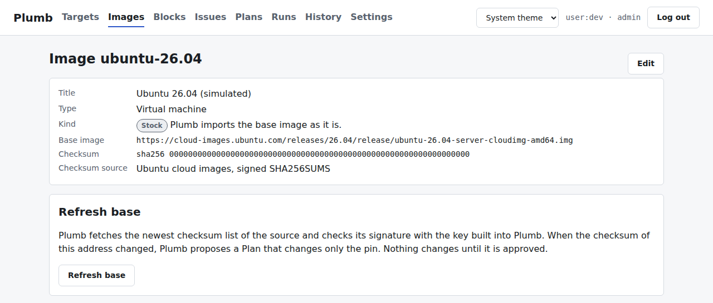
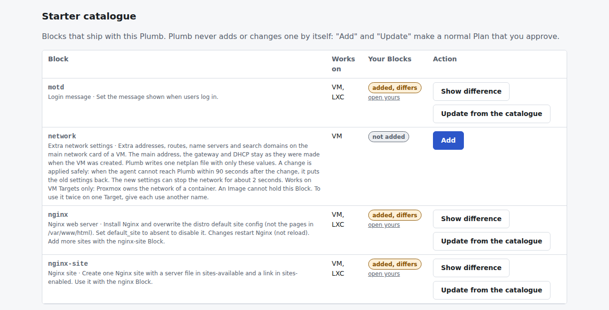
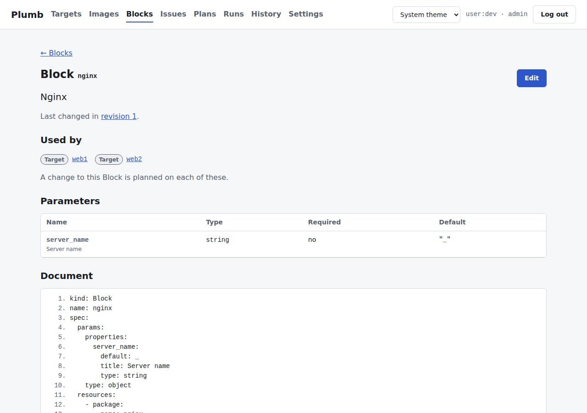
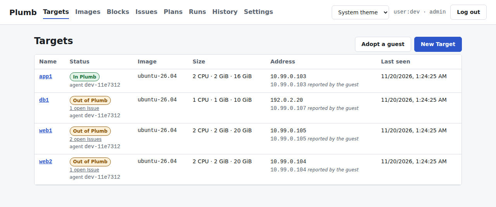
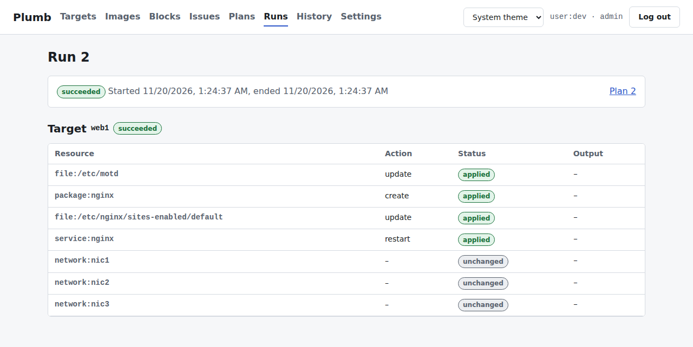
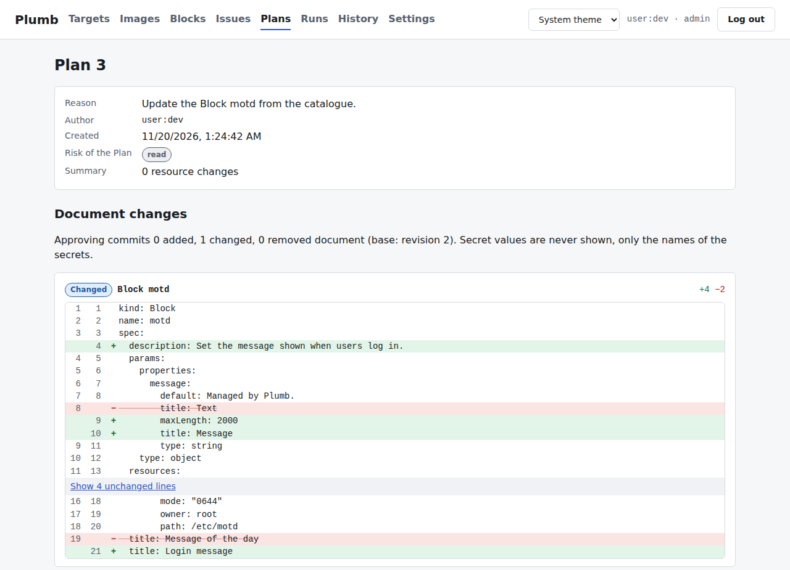
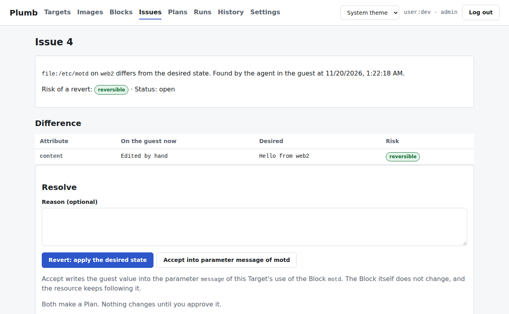
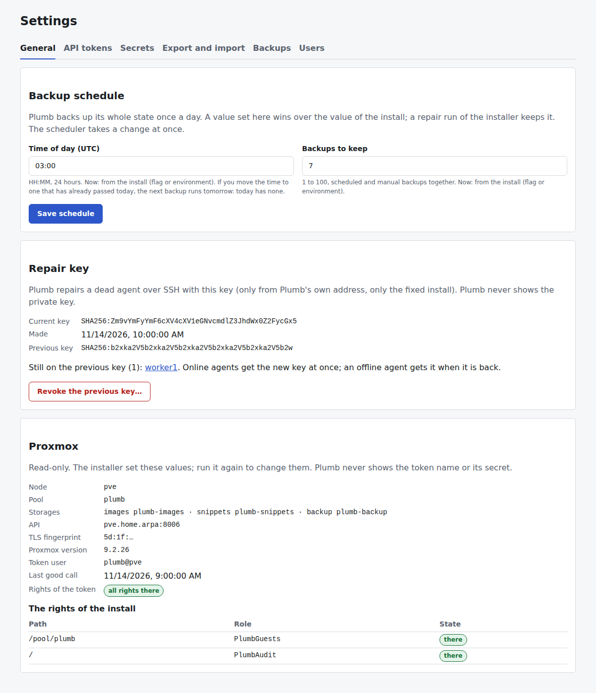
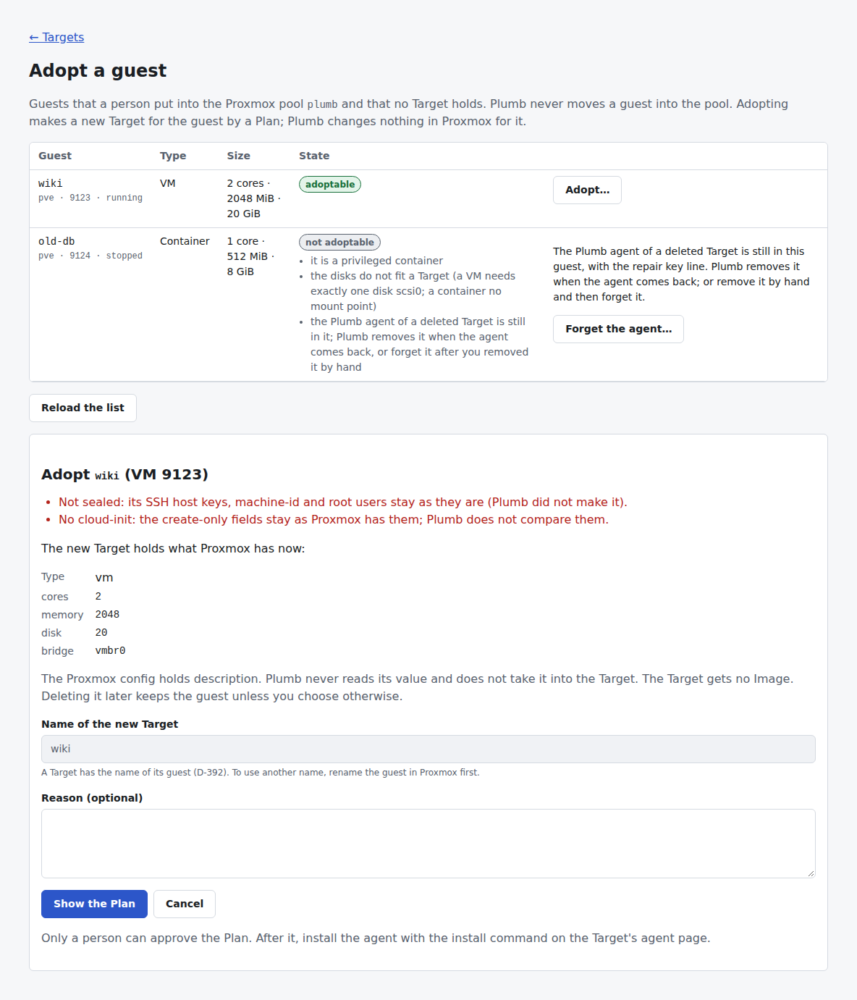
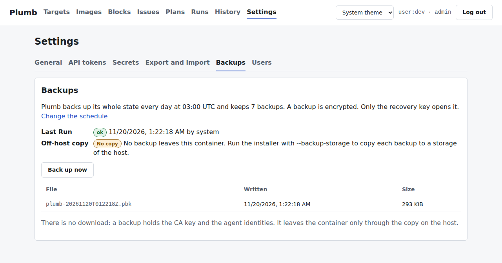

# Plumb

Plumb manages the virtual machines and containers on one Proxmox host. You run it yourself, in
your own network.

- **Images:** Plumb downloads cloud images and container templates. It can build its own Image
  versions from them, on a schedule, and keeps a fixed number of versions.
- **Targets:** a Target is one guest, a VM or an LXC container. Plumb creates it from an Image, or
  adopts a guest that you made.
- **Blocks:** a Block is a reusable piece of configuration: files, packages, services, users,
  firewall, network and more. You add Blocks to a Target. An agent in the guest applies them.
- **Plans:** every change is a Plan first. The Plan shows each change and its risk. Nothing
  changes until you approve it.
- **Issues:** when a guest no longer matches its Target, Plumb opens an Issue. You revert the
  change, accept it, or ignore it.
- **Users:** each person has their own login and a role: read, plan, apply or admin.
- **History and backups:** every approved change is a revision: who changed what, and why. Plumb
  backs up its own state every day, and can back up your guests.

You use Plumb in the web UI. Everything in the UI is also in the API, and an AI client can read
Plumb and propose Plans ([MCP](docs/guide/mcp.md)). Guests run Debian 13 or Ubuntu 26.04.

## Requirements

- Proxmox VE 9.1 or newer (qemu-server 9.2.11 or newer, libpve-storage-perl 9.1.13 or newer). The
  installer checks this and changes nothing on an older host.
- Root access to the host on a terminal (`ssh -t`). The installer asks questions and shows a key
  once.
- A storage for guest disks (default `local-lvm`) and a bridge (default `vmbr0`).
- A free IPv4 address for Plumb. Use a static address: the guests' agents keep this address. With
  DHCP, a new lease cuts off all agents.

## Install

### 1. Get the files

Until there is a release, build the binary yourself on a Linux machine with Go and Node.js 24 or
newer (versions: `go.mod`, `Makefile`):

```sh
git clone https://github.com/Bernotese/plumb.git
cd plumb && make build          # makes bin/plumb
```

Copy `bin/plumb` and `install/install.sh` to the Proxmox host.

**From a release tarball** (when there is one): check it **before** you unpack it, with
`gh attestation verify` (who built it) and the outer `SHA256SUMS` (see
[Verify a download](docs/RELEASE.md#verify-a-download)). Only
these two steps prove the whole tarball, `install.sh` included. Then unpack it as root into a
folder that only root can write, and run its `install.sh` with `--plumb-binary ./plumb` from there.

- The installer checks the tarball's own `SHA256SUMS` before it uses any file: every file must be
  there and match. Else it stops, names the file and changes nothing. This proves only that the
  files are whole, not who made them.
- The installer of a release says "Bundle check of release …". If the installer of a tarball says
  "source build" instead, stop: it is not the installer of a release.
- Run it from a clean root shell (for example `sudo -i`), not through `sudo -E` or a wrapper that
  passes your environment: `BASH_ENV` and `PATH` act before the first line of the script. A
  release installer uses `/tmp` for its temp files and refuses any other `TMPDIR`.

### 2. Dry run

The dry run prints every command that would change the host. It changes nothing.

```sh
bash install.sh --plumb-binary ./plumb --lxc-ip <address>/<prefix> --lxc-gw <gateway> --dry-run
```

Read the list. Use `bash install.sh --help` for all options (storages, bridge, VMID range, DNS).

### 3. Real run

Run the same command without `--dry-run`. The installer asks before it changes anything. It makes:

- an unprivileged Debian 13 LXC with the name `plumb` (2 cores, 1 GiB memory, an 8 GiB root disk
  and a 1 GiB volume for its key);
- a pool `plumb` for your guests, a user `plumb@pve` with an API token, and roles for it;
- the storages `plumb-snippets` and `plumb-images` (two directories on the host).

At the end it prints the address of the web UI and the first password of the user `admin`.

Two kinds of options are off unless you name them. The dry run lists each right that they add.

- **More networks for guests:** `--extra-bridge <bridge>` lets a guest network card use one more
  bridge, untagged. `--extra-vlan <bridge>:<tag>[,<tag>…]` allows these VLAN tags on a VLAN-aware
  bridge. Repeat each option for more. A Target can use only the bridges and tags named here.
- **Guest backups:** `--guest-backup-storage <storage>` names the one storage for backups of your
  guests. The installer refuses a storage that can also hold guest disks or snippets (content
  `images`, `rootdir` or `snippets`). A Proxmox Backup Server storage with an encryption key keeps
  the backups encrypted. On any other storage, Plumb makes guest backups only when you add
  `--guest-backup-clear`: the backups are then **not encrypted**, and each one holds the whole
  guest disk with every secret in it.

A later installer run (an update or a repair run) sets these rights from its options alone: give
every extra bridge, VLAN and the guest backup storage again, or its right is removed. Give
`--guest-backup-clear` again too: without it the run keeps the storage, and Plumb then refuses
every guest backup on a storage that does not encrypt.

### 4. The recovery key

During the install, Plumb shows a **recovery key** once. Plumb does not store it.

- Write it down and keep it offline, for example in a password manager or on paper.
- Without it, Plumb cannot read its backups or its stored secrets after a restore.
- Do not put it in a file on the Proxmox host or in a Plumb guest.

### What the Plumb token may do

Plumb never gets root access to Proxmox. Its token may:

- create, change, start, stop and delete guests in the pool `plumb`;
- use space on the disk storage and on `plumb-snippets`, and connect guests to the guest bridge;
- download images and templates into `plumb-images`;
- with `--extra-bridge` or `--extra-vlan`: connect guests to exactly those bridges and VLAN tags;
- with `--guest-backup-storage`: back up the guests of the pool to that storage, and use its space.

With guest backups on, the token itself can back up, restore over and delete the backups of every
guest in the pool directly at the Proxmox API. Plumb's own rules (for example "only a person
restores a guest") hold only inside Plumb, not for somebody who holds the token.

It can also read, but never change, data of the whole host. It needs this right (`Sys.Audit` on
`/`) to see the free space of the disk storage, and Proxmox gives no narrower right for it. So
Plumb can read, for example (the dry run prints the full list):

- the IDs, names and CPU, memory and disk use of **all** guests, also outside the pool;
- the task list of all users, root included (not the task logs);
- the backup jobs and the guests in them;
- the host and datacenter settings: disks and SMART data, `/etc/hosts`, the node config, and the
  cluster firewall rules.

It cannot read the configuration of a guest outside the pool, the syslog or the network settings.
It may not change guests outside the pool; change the host, its network, its storages or its
users; give rights to anybody or make new pools; open a console or use the QEMU guest agent. The
Plumb LXC itself is not in the pool, so Plumb cannot change itself.

**The rights in detail.** The installer makes one Proxmox role per line and gives each line to the
user `plumb@pve` and to its token `plumb@pve!plumb` (privilege separation). "Inherited" means that
the guests in the pool get the right too. Nothing else is given.

| Role                 | Path                                           | Privileges                                                                                                                                                                                                      | Inherited | Why                                                                     |
| -------------------- | ---------------------------------------------- | --------------------------------------------------------------------------------------------------------------------------------------------------------------------------------------------------------------- | --------- | ----------------------------------------------------------------------- |
| `PlumbGuests`        | `/pool/plumb`                                  | `VM.Allocate`, `VM.Audit`, `VM.Clone`, `VM.Config.CPU`, `VM.Config.Cloudinit`, `VM.Config.Disk`, `VM.Config.HWType`, `VM.Config.Memory`, `VM.Config.Network`, `VM.Config.Options`, `VM.PowerMgmt`, `Pool.Audit` | yes       | create, change, start, stop and delete the guests in the pool           |
| `PlumbDisk`          | `/storage/<disk storage>`                      | `Datastore.AllocateSpace`, `Datastore.Audit`                                                                                                                                                                    | no        | the guests' disks (`--disk-storage`, default `local-lvm`)               |
| `PlumbImages`        | `/storage/plumb-images`                        | `Datastore.AllocateTemplate`, `Datastore.Audit`                                                                                                                                                                 | no        | the downloaded cloud images and container templates                     |
| `PlumbSnippets`      | `/storage/plumb-snippets`                      | `Datastore.AllocateSpace`                                                                                                                                                                                       | no        | the cloud-init file of each VM                                          |
| `PlumbBridge`        | `/sdn/zones/localnetwork/<bridge>`             | `SDN.Use`                                                                                                                                                                                                       | no        | connect guests to the guest bridge (`--bridge`, default `vmbr0`)        |
| `PlumbNode`          | `/nodes/<node>`                                | `Sys.AccessNetwork`                                                                                                                                                                                             | no        | download the base images from their address onto the host               |
| `PlumbAudit`         | `/`                                            | `Sys.Audit`                                                                                                                                                                                                     | no        | read the free space of the disk storage (read only; see above)          |
| `PlumbBridge`        | `/sdn/zones/localnetwork/<extra bridge>`       | `SDN.Use`                                                                                                                                                                                                       | no        | only with `--extra-bridge`: one line per bridge                         |
| `PlumbBridge`        | `/sdn/zones/localnetwork/<extra bridge>/<tag>` | `SDN.Use`                                                                                                                                                                                                       | no        | only with `--extra-vlan`: one line per VLAN tag, never the whole bridge |
| `PlumbGuestBackupVM` | `/pool/plumb`                                  | `VM.Backup`                                                                                                                                                                                                     | yes       | only with `--guest-backup-storage`: back up the guests in the pool      |
| `PlumbGuestBackup`   | `/storage/<guest backup storage>`              | `Datastore.AllocateSpace`, `Datastore.Audit`                                                                                                                                                                    | no        | only with `--guest-backup-storage`: write and list the guest backups    |

## First steps

1. Open `https://<plumb-address>:8443`. The certificate comes from Plumb's own CA, so your browser
   warns you once. Plumb is for your local network only.
2. Log in as `admin` with the password that the installer printed. If you lost it:
   `pct exec <plumb-vmid> -- journalctl -u plumb.service | grep Password`.
3. Set a new password. Plumb asks for it at the first login.
4. **Images:** add an Image (a Debian or Ubuntu cloud image, or a container template). You can
   switch on a build with Blocks and a schedule.

   
   <br>_An Image: where the base image comes from, and its checksum._

   An Image keeps a fixed checksum (the pin). To move it to a newer file, choose a **signed
   checksum source** on the Image, then click **Refresh base**. When the file changed, Plumb
   proposes a Plan that changes only the checksum. Existing Targets do not change; new Targets and
   new builds use the new file.
   - Ubuntu cloud images: Plumb checks `SHA256SUMS` with the Ubuntu key that is built into Plumb.
   - Proxmox container templates: Plumb checks the appliance index with the Proxmox key that is
     built into Plumb.
   - Debian cloud images: Plumb reads `SHA512SUMS` over HTTPS. Debian does not sign this list, so
     every new Debian checksum needs a person.

   
   <br>_An Image with a signed checksum source, and the "Refresh base" button._

5. **Blocks:** the **starter catalogue** on the Blocks page lists the Blocks that ship with Plumb
   (for example `deploy-user`, `ssh-hardening`, `nginx`, `docker-engine`, `firewall`, `network`).
   "Add" copies one into your Blocks. When your copy differs from the catalogue, "Show difference"
   shows how, and "Update from the catalogue" replaces your copy. Both make a normal Plan. Plumb
   never adds or changes a Block by itself. Change the Blocks or write your own.
   - The `firewall` Block drops incoming traffic except the ports you list, on every network card
     of the guest. SSH always stays open.
   - The `network` Block adds addresses, routes, name servers and search domains to the first
     network card of a VM. The main address, the gateway and DHCP do not change.
   - When a `firewall` or `network` change cuts the guest off from Plumb, the agent puts the old
     settings back after 90 seconds.
   - A Block can also hold a local `group`; users join it through their `groups`.
   - While you edit a Block, a **preview** next to its YAML shows the form that a Target gets for
     its parameters and the resources that it makes; a resource that Plumb would refuse is marked.
     Nothing is saved until you make the Plan.

   
   <br>_The starter catalogue: "Add" and "Update" make a Plan. Plumb never changes a Block by itself._

   
   <br>_A Block: the Targets that use it, its parameters and its document._

6. **Targets:** make a Target. Choose the Image, the size and the Blocks. Later you can change
   these on the Target, also through a Plan:
   - **Power:** "running" or "stopped". A stop needs "Plumb may restart this VM" (for a container:
     "this container") on the Target.
   - **Tags:** the Proxmox tags of the guest. Plumb keeps exactly these. With no entry, Plumb does
     not touch the tags of the guest.
   - **Disk:** it only grows. Proxmox cannot make a disk smaller, so a grow cannot be undone.
   - **More network cards:** up to 3 more, on the bridges and VLAN tags that the install named.
   - **Data disks:** up to 3 more disks on the disk storage of the install. **Removing a disk
     deletes its data**, and only a person can approve it.
   - **Guest backups:** daily or weekly at a time (UTC), and how many to keep (see
     [Guest backups](#guest-backups)).

   The details of network cards and data disks: [docs/guide/targets.md](docs/guide/targets.md).

   
   <br>_The Targets: one is in Plumb, three have drift._

   
   <br>_One Target: its address, its Image and its guest settings._

7. **Plan:** "Show the Plan" opens the Plan. Read it, then click "Approve and apply". The Run shows
   each step. A Run can end as "succeeded, N warnings": then read the steps marked `warning`. The
   Plan shows two things:
   - **Document changes:** what changes in your Images, Blocks, Targets and rules, as a diff. Secret
     values are never shown, only the names of the secrets.
   - **Targets:** each change on each guest, with its old value, new value and risk. A change to a
     Block that no Target uses has document changes only.

   
   <br>_A Plan: every change with its old value, new value and risk. Nothing changes before you approve it._

   
   <br>_The Run of that Plan: each step on each Target._

   
   <br>_A Plan that changes only a Block: its document changes, line by line._

8. **Issues:** when somebody changes a guest by hand, an Issue opens. Choose "Revert", "Accept" or
   "Ignore" (once, or by a rule for this or every Target).
   - **Only a person** can approve a Plan that takes a value that a guest reported into the desired
     state (an Accept, also when you type the value yourself), and a Plan that removes the
     `firewall` of a Target (it opens every port at once). An API token cannot.
   - **Accept into a parameter:** when the changed value comes from one Block parameter, Accept
     writes the guest value into that parameter of this Target. The Block itself does not change.
     When no parameter fits, Accept keeps the value as a raw resource of this Target, and the Issue
     says why.

   
   <br>_An Issue: someone edited a file in the guest by hand. Revert it, accept it, or ignore it._

In **Settings** you make API tokens, store secrets, and export or import the whole state. Under
**Settings → General** an admin changes the backup time and the number of backups to keep; a value
set there wins over the value of the install, and "Use the install value again" goes back. The same
tab shows the Proxmox connection (node, pool, storages, version, the token's user and its rights)
and the repair key. It never shows a secret.


<br>_Settings → General: the backup schedule and the Proxmox connection._

### Users and roles

An admin adds people in **Settings → Users**. Each user has one role:

| Role  | May                                                                                                                               |
| ----- | --------------------------------------------------------------------------------------------------------------------------------- |
| read  | See everything. Change nothing.                                                                                                   |
| plan  | Also propose changes (Plans), comment on Issues, and drop Plans.                                                                  |
| apply | Also approve Plans up to the risk "disruptive", ignore drift once, and start a backup now.                                        |
| admin | Everything: destructive Plans, users, API tokens, secrets, an export with secret values, import, and the confirm after a restore. |

- Plumb makes a one-time password for a new user and shows it once. The user must change it at the
  first login.
- Plumb never deletes a user. Disable it instead. A name is never given twice.
- A role change ends every session of that user.
- The web UI hides the buttons that your role may not use. Plumb also checks every call itself.
- An API token has the tier read, plan or apply. A token never approves a Plan that only a person
  may approve.


<br>_Settings → Users: each person with their role and state._

### AI clients (MCP)

`plumb mcp` lets an AI client (for example Claude) read Plumb and propose Plans, through the Model
Context Protocol with an API token of the tier plan. It can never approve a Plan, ignore drift
directly, or touch secrets, tokens, users or settings. A Plan that it proposes may still hold an
ignore rule or the guest backup setting of a Target: that is safe only because the client cannot
approve its own Plan, and the risky parts need a person (a rule change always, and a lower keep is
destructive). The prompt **explain_issue** lets it explain an
Issue and propose one Revert or Accept. Setup and the full list:
[docs/guide/mcp.md](docs/guide/mcp.md).

## Updates and repair

To update Plumb, run the new `install.sh` with the new `plumb` binary. Use the same options as at
the install, with every extra bridge, VLAN, the guest backup storage and `--guest-backup-clear`: a
run without one of them removes its rights (see [Real run](#3-real-run) above). The same run repairs a broken install, and adds rights when you add
`--extra-bridge`, `--extra-vlan` or `--guest-backup-storage`. Try `--dry-run` first.

Agents in the guests never update by themselves: each update is a Plan that a person approves.
After an update of Plumb, the agent page of each Target shows one of these states:

- **Update available:** this Plumb serves a newer agent, and the old one still applies the desired
  state. Update it when it suits you.
- **Update required:** the desired state needs things that this agent does not know. Plumb refuses
  every Plan of the Target until the agent is updated.
- **Manual update:** the agent is too old to update itself. Run the one-time root command in the
  guest (see [Guests made before the agent self-update](#guests-made-before-the-agent-self-update)),
  or make the Target again.

For the first two, use **Propose agent update** on the agent page, once per Target. Plumb proposes
the update Plan by itself only when the new agent can do other things than the old one. An agent
that does not reach Plumb within 5 minutes after the update goes back to its old version by
itself.

**Container Images built before this release.** A built container Image keeps the first-boot
files of the Plumb that built it. With a version built before this release, a new container can
miss its agent at its first boot: the create Run ends with "the agent of … did not come online",
and the agent page says "no agent yet". Before you make new containers from such an Image,
use **Build now** on its Image page: the new version has the fixed files. For a container that
missed its agent, the repair over SSH cannot help (its agent never wrote the repair key line):
use **Make an install command** on its agent page and run the command in the container. A stock
container Image needs nothing: Plumb packs its template again the next time it is used.

### Repair a dead agent

When the agent of a running guest is offline, the agent page offers **Propose repair**. Plumb
refuses it during the first 10 minutes, because an agent may only be cut off for a short time. Only
a person can approve the repair Plan. After the approval, Plumb connects to the guest over SSH with
its own repair key and installs the agent again; nothing else runs in the guest. A failed repair
leaves the guest as it was.

- The agent writes a key line for root that allows only this install, and only from Plumb's
  address. The agent page says "ready" or why not. In the `ssh-hardening` Block, the
  `permit_root_login` values `prohibit-password` (the default) and `forced-commands-only` both allow
  the repair; `no` turns it off.
- Plumb pins the SSH host keys that the agent reported, and the repair connects only to a pinned
  key. A new host key shows as a warning. When no pinned key is left (the guest got new host keys),
  the repair is off until you accept one of the new keys in the repair Plan; check it on the guest
  first, for example with `ssh-keygen -lf /etc/ssh/ssh_host_ed25519_key.pub`.
- **Settings → General** shows the repair key. "Make a new repair key" makes a new one; the old key
  stays valid until you revoke it.
- Without a repair over SSH (a container without SSH, a guest that never had the line, an adopted
  guest), an admin makes an **install command** on the agent page: one root command for the guest,
  valid once for 15 minutes. It holds a one-time token, so treat it as a secret; Plumb shows it only
  once. **It needs `curl` in the guest**; a stock Debian LXC has none. Install it first
  (`apt-get install -y curl`). Every error line starts with `plumb-install:`. Without `curl`, or
  when the download fails or is cut, the command stops with one such line, installs nothing and
  leaves no file; you can run the same command again.
- The shell keeps a pasted command, with the token, in root's history. Run `unset HISTFILE` before
  you paste it, or `history -c` after it. After a failed try, the token stays valid until its time
  ends.


<br>_A dead agent: Plumb can install it again over SSH, after a person approves the Plan._

### Adopt a guest

Plumb can take over a guest that you made yourself. Move the guest into the Proxmox pool `plumb`
first; Plumb never moves a guest into the pool. Then open **Targets → Adopt a guest**.

- The list shows each free guest of the pool, and why a guest cannot be adopted (for example more
  than one disk, a VLAN tag, a privileged container).
- The new Target has the Proxmox name of the guest; rename the guest in Proxmox to change it.
- An adopted Target keeps one network card and the disks that it has: Plumb adds none.
- Adopting is a Plan that only a person can approve. Plumb writes nothing to Proxmox for it.
- The guest is **not sealed**: its SSH host keys, machine-id and root users stay as they are.
  Plumb never keeps or shows its password, SSH keys, description or container environment.
- Install the agent with the install command on the agent page (it needs `curl` in the guest; see
  "Repair a dead agent").
- **Delete:** deleting an adopted Target lets the guest go: Plumb removes its agent, and the guest
  and its disks stay in Proxmox. Only when you first allow it with a separate Plan ("Allow Plumb to
  delete the guest") does deleting the Target delete the Proxmox guest and its disks. Allowing the
  guest delete, and the delete with it, needs a person; the plain delete is a normal disruptive Plan.
- When the agent does not answer during the delete, the Run ends as "succeeded, 1 warning" and the
  agent stays in the guest with its repair key line. The guest then shows under **Adopt a guest**
  as not adoptable ("the Plumb agent of a deleted Target is still in it"). Plumb removes the agent
  when it comes back. Or remove it by hand (the warning step names the commands) and choose
  "Forget the agent…" (admin).


<br>_Adopt a guest: the warnings come before the Plan._

### Guests made before the agent self-update

These guests need one root command per guest, once:

```sh
# LXC, on the Proxmox host:
pct exec <vmid> -- sh -c 'systemctl stop plumb-agent.service && /usr/local/sbin/plumb-agent-install'
# VM, over SSH or the console, as root:
systemctl stop plumb-agent.service && /usr/local/sbin/plumb-agent-install
```

After it, the Target page shows the new agent version. A guest without
`/usr/local/sbin/plumb-agent-install` must be made again.

An update never changes a stored Block. If your `nginx` or `nginx-site` Block answers 403, replace
its `index index.html;` line with `index index.html index.htm index.nginx-debian.html;`.

### Remove Plumb

`bash install.sh --remove`. It refuses while the pool still holds guests or templates. Delete the
Targets and Images through Plumb first, then remove in Proxmox the templates that stay (see "Known
limits").

## Backup and restore

### Plumb's own backups

Plumb backs up its whole state every day at 03:00 UTC and keeps the last 7 backups (installer
options `--backup-time` and `--backup-keep`, or **Settings → General**). **Settings → Backups**
shows them, and "Back up now" makes one at once. A file that Plumb cannot read is listed as
unreadable: give it to the user `plumb` in the container.


<br>_Settings → Backups: the schedule, the last run, the off-host copy and the backups._

A backup is encrypted. Only your recovery key opens it.

- It holds: every Image, Block, Target, rule and revision, the history, the Issues, the users and
  tokens, which guest belongs to which Target, and the identities of the agents.
- It does not hold: the recovery key, the Proxmox token of Plumb (the installer makes a new one),
  and the guests themselves. Back up the guests with Plumb's guest backups (below) or with Proxmox.

### Copy the backups off the host

The backups live in the Plumb LXC. If the disk of the host dies, they die with it. Copy them to a
storage on another device, for example an NFS or CIFS share:

```sh
bash install.sh --plumb-binary ./plumb <your usual options> --backup-storage <storage>
```

The host copies the newest backup to `<storage path>/plumb-backups/` every day (30 minutes after
the backup) and keeps 14 copies. The storage must exist in Proxmox (`dir`, `nfs`, `cifs` or
`cephfs`). A directory on the same host is not an off-host copy. Settings → Backups shows the state
of the last copy. `--backup-storage none` stops the copies; the copies stay.

Check a copy now and then on the host. It asks for the recovery key and changes nothing:

```sh
./plumb backup verify <storage path>/plumb-backups/<file>.pbk
```

This proves that the file opens with your key. Only a real restore proves the whole way back.

### Replace the controller

To move Plumb to a new LXC, or after the Plumb LXC broke, keep the guests and restore:

1. Remove only the controller. Plumb takes a fresh backup, copies it to the backup storage, and
   checks it with your recovery key. A wrong key stops here, before any change. The pool and its
   guests stay.

   ```sh
   bash install.sh --remove --keep-guests --plumb-binary ./plumb
   ```

   Without `--backup-storage` at the install, add `--backup-to <directory>`: a directory on this
   host. That is not an off-host copy; the installer warns you.

2. Restore. Use the whole line that the installer prints at the end of step 1, not a line of your
   own. It has the same address as before (the agents in the guests know only this address), the
   backup storage, and every option of the install that is not the default (rights, storages,
   VMID range, DNS, backup settings); defaults are left out on purpose. It looks like this:

   ```sh
   bash install.sh --plumb-binary ./plumb --restore <file>.pbk --lxc-ip <address>/<prefix> --lxc-gw <gateway> --backup-storage <storage> <the other options of the install>
   ```

   The installer asks for the recovery key and checks the file before it changes anything. A wrong
   key stops the run. A restore without the options of the old install gives the restored Plumb no
   rights for those networks, turns guest backups off, and takes the defaults for the rest; the
   installer warns before it starts. An install made before this version did not store all its
   options. Then the printed line ends with `<UNKNOWN: …>`, and the shell refuses to run it: add
   the options of the old install by hand. These are `--extra-bridge`, `--extra-vlan`,
   `--guest-backup-storage`, `--guest-backup-clear`, `--pool`, `--bridge`, `--disk-storage`,
   `--image-storage`, `--template-storage`, `--snippet-dir`, `--image-dir`, `--lxc-id`,
   `--vmid-range`, `--nameserver`, `--searchdomain`, `--backup-time`, `--backup-keep`,
   `--backup-copy-time`, `--backup-copy-keep` and `--backup-max-size`, as far as the install used them.

### After a restore

Do these in this order: set the new admin password, confirm the restore, then enable the users and
the API tokens that you still need. Until the password is changed, the login can do nothing else.

- The installer shows a new password for `admin` once. Write it down. Each login with it asks for
  the new password first. After the change only the new password works; the old passwords do not
  work any more.
- Plumb starts in **restored mode**: it reads Proxmox and the agents, but it changes nothing. No
  Plan is applied and no backup runs. A banner says so.
- Every other user is locked. **Settings → Backups** lists them: give a user a one-time password
  there; they choose their own password at their first login.
- Every API token is disabled. Enable only the ones you still need, in Settings → API tokens (a
  person must do it, after the new admin password is set).
- When the old controller is off for good, confirm it in **Settings → Backups**. Only then does
  Plumb work normally again. Two controllers must never manage the same guests: both would change
  them. With the API, a person confirms with `POST /api/v1/restore/confirm` and the body
  `{"old_controller_off": true}`, after the password change; without that field the call is
  refused.
- Guests that were made after the backup are listed as unknown guests. Plumb never changes or
  deletes them. A guest that was deleted after the backup gets an Issue; Plumb does not make it
  again by itself.
- Guest backups made after the backup of Plumb show under "Backups that Plumb does not know":
  Plumb never deletes them.

### Guest backups

With `--guest-backup-storage` at the install, Plumb backs up the guests of your Targets on a
schedule that you set per Target, and keeps as many as you say. The **Backups** page of a Target
lists them and has **Back up now**.

A restore over the same guest is a Plan with the risk destructive: only a person with the role
admin can approve it. Proxmox empties the guest before it writes the backup, so Plumb first takes a
**safety backup** of the guest as it is. After the restore the agent enrolls again through a Plan
that you approve. Everything written in the guest after the backup is lost, and access that a
person removed later (SSH keys, passwords) works again.

The details, the safety backup, and what to do when a restore fails:
[docs/guide/guest-backups.md](docs/guide/guest-backups.md).

### Export and import

**Settings → Export and import** saves one YAML file with every Image, Block, Target and rule. It
does not hold the history, the Issues, the users or the tokens. It does not hold which guest belongs
to which Target, or the agent identities: a new Plumb made from it creates new guests. Secret
values are in it only when you give a passphrase. Keep the recovery key in any case.

## Known limits

- One Proxmox host only. No clusters.
- A restored Plumb needs the same address as before.
- The address and the gateway of the first network card cannot change after the guest is made.
  For a new address, make a new Target, or change it by hand.
- When Plumb applies a network change in a VM (the `network` Block or a network card), `netplan
  apply` can drop the guest's address for a moment. Adding a network card also makes the guest ask
  the DHCP server again for the address of its main card. If your DHCP server may hand out another
  address then, give the guest a static address or a DHCP reservation.
- A change of cores or memory of a running VM waits for a restart. Switch on "Plumb may restart
  this VM" on the Target if Plumb may restart it.
- A **stock Ubuntu 26.04** image used directly by a Target can stay on DHCP until its first
  restart. Use DHCP, or let Plumb build the Image: a built Image does not have this limit.
- The **5 minute agent guard:** when Plumb is not reachable for more than 5 minutes right after an
  agent update, the agent goes back to its old version. A new update Plan installs it again.
- A guest has at most 4 network cards, on the bridges and VLAN tags named at install. The `network`
  Block adds addresses and routes on the first card.
- Data disks live only on the disk storage that the install named, at most 3 per guest. There are
  no bind mounts and no mount options. A container disk path is checked by its name only: if a
  Block makes a part of that path a symbolic link in the guest, the container cannot start with the
  disk, and Plumb removes the disk again.
- Plumb restores a guest backup only over the same guest, not after the guest is gone: that would
  need a Proxmox right that opens every backup on the storage. Restore it in Proxmox into the pool
  `plumb`, then adopt the guest.
- Proxmox Backup Server: Plumb reads from the storage config whether a backup storage encrypts.
  This was not tested on a real Proxmox Backup Server.
- A change by hand with `ip` or `nft` in a guest that uses the `network` or `firewall` Block is seen
  within seconds. When the agent cannot watch it live, its agent page says so, and the change is
  seen at the full check every 15 minutes.
- Deleting an Image removes its templates in Proxmox, but only templates that Plumb made for this
  Image and that no guest still uses (a linked clone). A template in use stays, and the Run says
  which. The downloaded files (cloud images, container templates) always stay. The delete Plan names
  each of them with the command that removes it. Remove what you no longer need in Proxmox.
- The first signed refresh of an Image, and every new checksum of a Debian Image, needs a person:
  an API token cannot approve it.

## More

- [docs/guide/targets.md](docs/guide/targets.md): network cards and data disks in detail.
- [docs/guide/guest-backups.md](docs/guide/guest-backups.md): guest backups and restore in detail.
- [docs/guide/mcp.md](docs/guide/mcp.md): AI clients over MCP.
- [docs/RELEASE.md](docs/RELEASE.md#verify-a-download): how to check a release.
