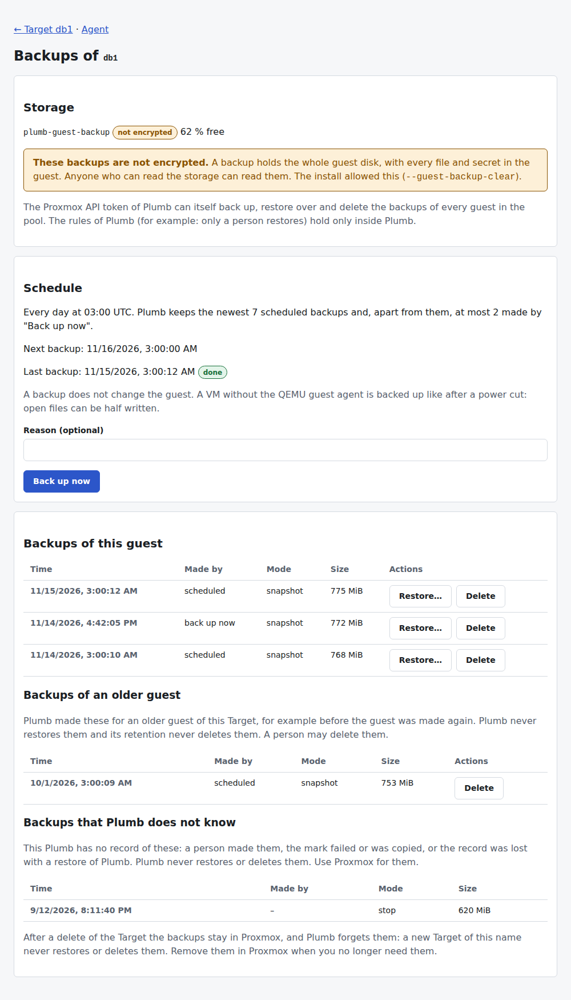
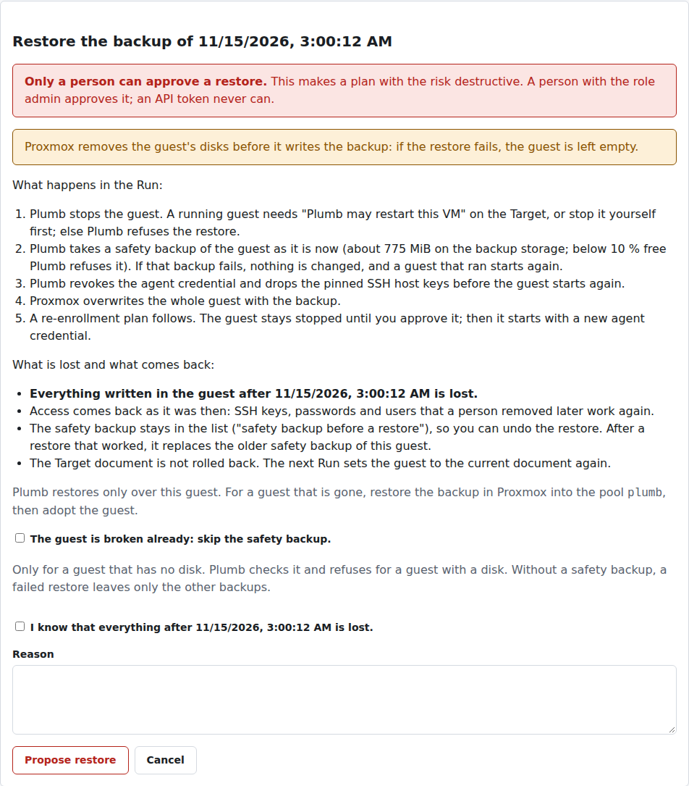

# Guest backups and restore

The details behind "Guest backups" in the [README](../../README.md#guest-backups). Guest backups
need `--guest-backup-storage` at the install.

## Backups

Set **Guest backups** on a Target: daily or weekly, a time (UTC), and how many backups to keep (1
to 30). A backup does not change the guest. It is a snapshot: a VM without the QEMU guest agent is
backed up like after a power cut, so open files can be half written.

**What a backup holds.** A VM backup holds the whole disk, also the agent credential; Plumb revokes
that credential at a restore, and every re-enroll makes the credential in older backups useless. A
container backup leaves out only the agent's secrets (its credential, a left-over enroll token and
its desired list); its config stays, and a restored container starts its agent and re-enrolls.

The **Backups** page of a Target shows:

- the storage, whether it encrypts, and its free space. Below 10 % free, Plumb refuses new backups;
- the schedule, the next and the last backup;
- **Back up now** (role apply or admin). Plumb keeps at most 2 of these beside the scheduled ones,
  so they never push out a scheduled backup;
- the backups, in three groups:
  - **this guest:** Plumb made them. Plumb keeps the newest scheduled ones as set, restores them
    and deletes the oldest;
  - **an older guest of this Target**, for example before the guest was made again: Plumb never
    restores them and never deletes them by itself;
  - **not known to Plumb:** a person made them, the mark failed, or the record was lost with a
    restore of Plumb. Plumb never touches them. Delete them in Proxmox. When another backup of the
    guest ran at the same time as Plumb's, Plumb finds its own one by its Proxmox task and lists it
    under this guest; only the other one shows here.

 _The backups of one guest: the storage state, the schedule and the backups by group._

A person with the role admin can delete one backup of the first two groups, after a confirm.

A change of the backup setting is destructive only when the next backup job would delete more
backups than it would now. The Plan says how many. Removing the backup setting stops the backups
and deletes none. After a delete of the Target the backups stay in Proxmox, and Plumb forgets them,
the safety backups too. Delete them in Proxmox when you no longer need them.

## Restore

"Restore…" on a backup of this guest opens a wizard. It makes a Plan with the risk destructive,
and only a person with the role admin can approve it; an API token never can. Plumb restores only
over the same guest. For a guest that is gone, restore the backup in Proxmox into the pool
`plumb`, then adopt the guest ("Adopt a guest" in the README).

 _The restore wizard says what is lost, and that Plumb first takes a safety backup._

Before anything changes, Plumb reads the network settings in the backup. If a network card of the
backup is on a bridge or VLAN tag that the install does not name, Plumb refuses the restore (also
the restore of a safety backup), and nothing is changed. The message names the options that it
needs: run the installer again (a repair run) with every extra bridge and VLAN that the install has
now, plus these; or restore another backup.

The Run:

1. stops the guest. A running guest needs "Plumb may restart this VM" (for a container: "this
   container") on the Target, or stop it yourself first;
2. takes a safety backup of the guest as it is now (see below). If that backup fails, nothing is
   changed, and a guest that ran starts again;
3. revokes the agent credential and drops the pinned SSH host keys, before the guest starts again;
4. lets Proxmox overwrite the whole guest with the backup;
5. then Plumb proposes a re-enrollment of the agent (the guest stays stopped until you approve
   it). When a re-enrollment Plan of the Target is still open, Plumb makes no second one: approve
   that one. An adopted guest starts without an agent: run an install command from its agent page.

Everything written in the guest after the backup is lost. Access comes back as it was then: SSH
keys, passwords and users that a person removed later work again. The Target is not rolled back:
the next Run sets the guest to the current Target again.

The restored guest runs the agent that was in the backup. When that is an older version, its agent
page shows **Update available**: propose the agent update.

**A backup older than a data disk** does not hold that disk. The restore Plan names each such disk
and what happens to it:

- a **VM** keeps the disk as an unused volume. Free it in Proxmox when you no longer need it. If
  the Target's disk list names that slot, the next Run attaches a new, empty disk there;
- a **container** loses the data on that disk. If the Target's disk list names that slot, the next
  Run makes a new, empty disk at its path.

The safety backup holds the disk in both cases.

### After the restore: the re-enrollment

After a restore that worked, the Issue `guest:restore-failed` stays open with "restored; the agent
is not enrolled yet" until the re-enrollment **Run** worked; then it ends with a comment. Its page
names the re-enrollment Plan to approve. If that Plan can no longer run (another Plan changed the
configuration first, it was dropped, or its Run failed), the Issue says so: plan the
re-enrollment again ("Propose the re-enroll" on the Issue page). While the guest waits for its
agent:

- the disks are the restored ones, so Plans of the Target are allowed, and Plumb compares the
  guest again (a drift Issue gets its actions). Use this to fix the Target when the re-enrollment
  failed because of it;
- a Run of such a Plan changes the guest in Proxmox and skips the steps inside the guest. The
  re-enrollment Run does them with the new agent, and it also grows the root file system when a
  disk grow is still waiting for it.

If the restore worked but Plumb cannot plan the re-enrollment (for example because a person added
a mount point to the container in Proxmox), the Issue says why, with the way out: fix it in
Proxmox, then re-enroll.

### The safety backup

Proxmox removes the guest's disks before it writes the backup. If the restore fails, the guest is
left empty. So the Run first takes a safety backup of the guest. It shows in the list as "safety
backup before a restore", and "keep" never counts or deletes it.

- After a restore that worked, it stays, so you can undo the restore; it replaces the older safety
  backup of the guest.
- After the restore of a safety backup itself, Plumb keeps that one and every newer one, and
  deletes only older safety backups.
- If the controller stops during a restore, the older safety backups of that guest stay until its
  next restore that works; you may delete them in Proxmox.

Two cases take no new safety backup:

- the last restore failed: the guest may be empty, so the safety backup from before stays the way
  back. The Plan says so. After a restore that worked, the guest is not broken: the next restore
  takes a new safety backup, and "skip the safety backup" is refused;
- the guest has no disk: a person may tick "The guest is broken already: skip the safety backup"
  in the wizard. Plumb checks it and refuses for a guest with a disk. An API token never can.

### When a restore fails

If the restore fails, the Run says that the guest may have no disk, and Plumb opens the Issue
`guest:restore-failed`. It names the safety backup, and its link opens the restore of that backup.
A restore that works moves the Issue to "restored; the agent is not enrolled yet" (above). When
Proxmox refuses a restore before it begins (for example a network that the install does not name),
the guest's disks are as before, and the Run says so.

If the controller stops during a restore, it checks the restore at its next start: when the restore
worked, it makes the re-enrollment Plan then; when it cannot tell, the Issue `guest:restore-failed`
says that the guest may have no disk. The Proxmox restore task may still have ended well: look at
the guest in Proxmox, or restore the safety backup that the Issue names.

While the Issue says that the restore failed (or that a restore runs), the guest may be empty, so
Plumb protects it:

- Plumb opens no drift Issue for the guest.
- Every Plan for the Target is refused, except a restore and a delete of the Target. Only a person
  can approve the delete.
- The other Issues of the Target show no action. They name the Issue of the failed restore, and
  their actions come back after a restore that works.
- Only a person with the role admin can end the Issue by hand ("End the Issue"), and only when the
  guest has a disk again (for example after a repair in Proxmox). Do not revert an empty guest:
  Plumb would make it again, and then no backup of it can be restored through Plumb.
