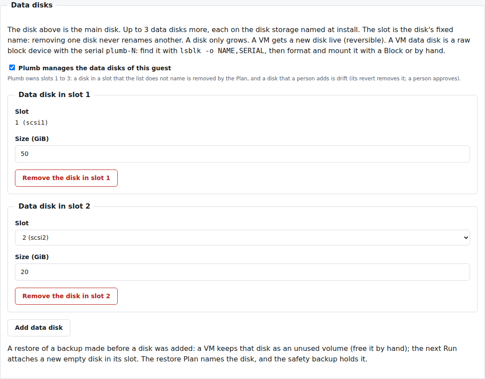

# Targets: network cards and data disks

The details behind the Target settings in the [README](../../README.md#first-steps). Every change
here is a Plan; nothing changes until you approve it.

## More network cards

A Target has up to 3 more network cards, each on a bridge, or a bridge with a VLAN tag, that the
install named (`--extra-bridge`, `--extra-vlan`). Each card has no address, DHCP, or a static
address; at most one card has a gateway. Plumb chooses the MAC addresses. Adding or removing a
card, or changing its bridge or tag, is disruptive: the Plan says so.

- A container gets the address of each card from Proxmox.
- In a VM, the agent sets it with netplan and finds the card by Plumb's MAC address. It refuses,
  and changes nothing, when a netplan entry names the card only by a pattern, or when two entries
  name it.
- A VM card gets a gateway only while the first card has no default route (also none from DHCP).
- A running VM gets or loses a card without a restart while network hot-plug is on (the Proxmox
  default); else the change waits for a restart. The agent removes the netplan file of a removed
  card. A card that comes back gets the same MAC address.
- Plumb refuses the Plan for a bridge or a VLAN tag that the install did not name. The message
  names the installer options that it needs. Run the installer again with every extra bridge and
  VLAN that the install has now, plus these (see
  [Updates and repair](../../README.md#updates-and-repair)).
- A network card changed in Proxmox (bridge, tag, MAC, a card added or removed) cannot be accepted
  in an Issue. Revert it, or change the network cards of the Target.

## Data disks

Up to 3 more disks after the main disk, on the disk storage that the install named. Tick "Plumb
manages the data disks of this guest" to manage them; then each disk has a **slot** (1 to 3) and a
size. The slot is the disk's fixed name (a VM `scsi1` … `scsi3`, a container `mp1` … `mp3`):
removing one disk never renames another.

 _The data disks of a VM: the slot is the disk's fixed name, and a disk only grows._

- **VM:** a data disk is a raw block device with the serial `plumb-<slot>`. Find it in the guest
  with `lsblk -o NAME,SERIAL` (it is not in `/dev/disk/by-id`). Formatting and mounting it is
  yours: with a Block or by hand. Plumb adds it live (reversible).
- **Container:** give a mount path, for example `/srv/data`. Proxmox makes a file system on the
  disk and mounts it there. The path cannot change later, and it cannot be in a system folder
  (`/etc`, `/usr`, `/var`, `/lib…` and the others) or inside another disk's path.
  - Plumb adds a container disk only while the container is stopped: the Run stops a running
    container, adds the disk and starts it again. That needs "Plumb may restart this container",
    and the Plan is disruptive.
  - If the container does not start with the new disk (for example because a part of the path is
    a symbolic link in the guest), the Run removes the disk again and starts the container as
    before.
  - A stopped container gets the disk and stays stopped (the Plan is reversible); the disk is then
    tried only at its next start. If that start fails, remove the disk with a Plan.
- A disk only grows. A grow is disruptive, as for the main disk.
- Every disk counts for the disk gate of the disk storage (85 % by default). A user or token with
  the role apply can approve an add (up to 3 × 4096 GiB per Target), but no remove.
- A disk that grew in Proxmox is drift: "Accept" takes the bigger size into the Target, and there
  is no Revert (a disk cannot shrink).
- An adopted Target keeps the disks that the guest has; Plumb adds none.

### Removing a disk

**Removing a disk deletes its data.** The Plan is destructive, and only a person can approve it. A
running guest needs "Plumb may restart this VM" (for a container: "this container"). The Run
detaches the disk first, then frees its volume in a second step. A disk that Plumb did not make is
only detached, never freed. Deleting the Target deletes its data disks too; the Plan names each of
them.

**If Plumb cannot free a volume**, the Run says so and Plumb opens the Issue `guest:volume-left`,
which names the volume. No disk is added to the Target until it is gone. Remove it on the Proxmox
host as root: `qm set <vmid> --delete unusedN` (for a container `pct set`), with the `unusedN` line
that names the volume, or `pvesm free <volume>` when no such line names it. A delete of the Target
also frees it. The Issue ends by itself at the next check (about a minute) when the guest config no
longer names the volume.

- A common cause is a **snapshot** of the guest that still uses the disk ("volume is still in use
  (snapshot?)"). Remove the snapshot first (`qm delsnapshot <vmid> <name>`), then the `unusedN`
  line.
- Never `pvesm free` a volume that an `unusedN` line still names: the line stays, the Issue stays
  open, and a later snapshot delete can leave the guest locked.

### Switching the box on or off

With the box off, Plumb does not touch data disks, and a disk that a person adds is no drift.
Switching it off deletes nothing. Switching it on manages slots 1 to 3. Read that Plan before you
approve it:

- A disk of a slot that the list does not name is removed, or detached when Plumb did not make it.
- **A disk that a person added to a VM** has no serial `plumb-N`, so Plumb never takes it over. If
  the list names its slot, Plumb refuses the Plan (remove the disk in Proxmox, or use another
  slot); else the Plan detaches it and does not free it. To keep it as it is, leave the box off.
- **A disk that a person added to a container** on the disk storage of the install counts as
  Plumb's: list it with its slot, size and path to keep it. A disk on another storage, a bind mount
  or a device, Plumb did not make: as for a VM, the Plan refuses or detaches it.
